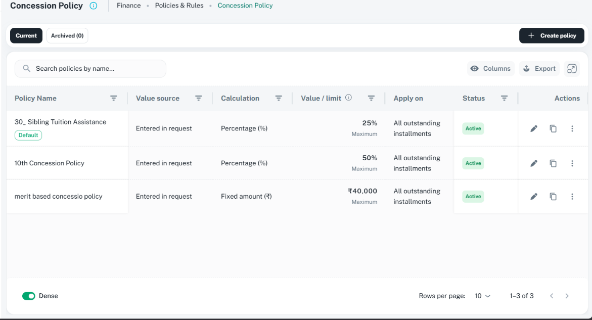
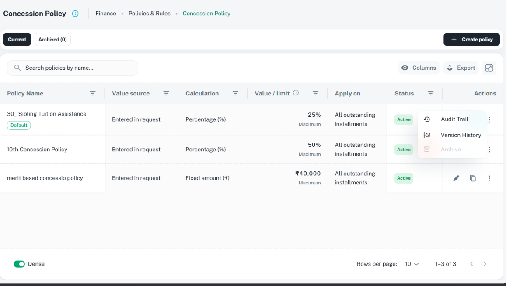

# AdaptiveThreeDotsActions: ShikshaMitra UI consistency

Use `AdaptiveThreeDotsActions` for table row actions. It owns the split between direct icon
buttons and an anchored three-dots menu. Follow the [table guide](tables.md) for column layout,
filter types, sticky behavior, and the left-aligned Actions heading. This guide documents the
existing component and the user's visual references; it does not change application code.

## Reference images

Supplied by the user and visually inspected on 16 October 2026. Both show Concession Policy under
Finance / Policies & Rules, light theme, populated table. Routes, viewport dimensions, and scale
are unknown; dimensions below describe image files. No numbered annotations were supplied.

| Reference | Asset | Preserve |
| --- | --- | --- |
| Direct actions, menu closed | [Closed menu](../assets/adaptive-three-dots-actions-closed.png), 1171 x 633 | Edit and Copy direct, then vertical three dots in the compact rightmost Actions column |
| Overflow menu open | [Open menu](../assets/adaptive-three-dots-actions-open.png), 1157 x 656 | Anchored compact menu; leading icons and left-aligned labels; Audit Trail, Version History, and disabled Archive as the illustrated overflow order |





These illustrate action placement and menu treatment, not universal operations. Other records
use their own allowed actions. Do not infer why Archive is disabled or copy Finance permissions
from a screenshot. The images' centered/right-aligned Actions heading is superseded by the
user's requirement that every column heading be left aligned.

## Action-count rule

Build the permitted, ordered action list first, then let the shared component split it.

| Available action count | Outside the menu | Inside the menu | Three dots |
| --- | --- | --- | --- |
| 0 | None | None | Hidden; component returns null |
| 1 | First action | None | Hidden |
| 2 | First two actions | None | Hidden |
| 3 | First two actions | Third action | Visible |
| 4 or more | First two actions | Every action from the third onward, in order | Visible |

- Use `directActionLimit={2}` and `collapseOnOverflow={false}`. Omit
  `mobileDirectActionLimit` to retain the same rule on mobile for this reference pattern.
- Never show three or more direct actions, duplicate direct items in the menu, or collapse the
  complete list into the menu merely because more than two actions exist.
- Order actions by stable product priority: frequent operations first, history/audit and less
  frequent operations later, consequential actions after safe ones. The image's Edit/Copy order
  is specific to that record; do not force Copy onto unrelated tables.
- Remove unauthorized actions before building the list. Keep an authorized but temporarily
  unavailable action disabled only when showing it helps explain a workflow restriction.
  Disabled entries still occupy their configured position; the component does not reorder them.

## Layout, icons, labels, and disabled states

| Concern | Standard / current source behavior |
| --- | --- |
| Column | Actions is rightmost and sticky; its heading is left aligned; no sort/filter controls; exclude it from export |
| Action group | One horizontal, vertically centered row; existing `gap: 1` (8 px); right-align controls within the cell with `sx={{ justifyContent: 'flex-end' }}` |
| Direct controls | Existing 30 x 30 px icon buttons, 16 px icons; no extra outlined/contained wrapper button |
| Overflow trigger | Shared vertical-dots icon after direct actions; same size, tooltip, accessible contextual `moreLabel` |
| Menu | Use the existing `CustomPopover` and dense `MenuList` supplied by the wrapper; paper surface, shadow, radius, spacing, and arrow come from shared theme/components |
| Menu labels | Short verb/task names; left aligned, leading icon on the left, consistent icon/text spacing; preserve existing family capitalization |
| Menu sizing | Shared popover list minimum width 140 px; grow for readable labels without forcing the screenshot's pixel dimensions |
| Menu icons | Existing wrapper uses 16 px icons; choose established `GlobalIcons` entries; decorative icons do not replace text |
| Disabled item | `disabled: true` plus an explanatory `tooltip`; shared neutral disabled icon/text treatment; cannot activate |
| Consequential action | Meaningful label/color and the appropriate feature-owned confirmation; do not use destructive coloring for safe history actions |

Use the shared icon and menu spacing as a whole. Do not add local margins to reproduce a screen
capture or introduce a second popover/menu implementation. Keep all actions visible and operable
at the table's right edge and near the viewport bottom. A menu must not be clipped by sticky
columns or the table scroll container; select the supported placement that fits the actual layout.

Labels on direct controls also supply their accessible names; include the record, such as
`Edit English`. Set `moreLabel` to `More actions for English` so the menu has row context. The
current API has no separate `ariaLabel`/`renderMenuItem` prop; do not invent one. If a future
design needs short visible labels and separate accessible descriptions, extend the shared API.

## Current API and component relationships

Inspected on 16 October 2026. Recheck the source before implementation.

| Component | Relationship / source |
| --- | --- |
| `AdaptiveThreeDotsActions` | Public wrapper: [implementation](../../../../src/components/adaptive-three-dots-actions/index.tsx), [types](../../../../src/components/adaptive-three-dots-actions/types.ts) |
| `ThreeDotsActions` | Internal icon buttons, trigger, popover: [implementation](../../../../src/components/three-dots-actions/index.tsx), [types](../../../../src/components/three-dots-actions/types.ts) |
| `CustomPopover`, `usePopover` | Internal anchor/open/close state: [popover](../../../../src/components/custom-popover/custom-popover.tsx), [hook](../../../../src/components/custom-popover/use-popover.ts), [placement calculation](../../../../src/components/custom-popover/utils.ts) |
| `Iconify`, `GlobalIcons` | [Icon rendering](../../../../src/components/iconify/iconify.tsx), [shared icon names](../../../../src/utils/icons.ts) |
| `CustomTooltip` | Disabled overflow-item explanation: [component](../../../../src/components/custom-tooltip/index.tsx); direct controls use MUI Tooltip |
| `CustomizableTable` | Host Actions column: [table guide](tables.md), [column types](../../../../src/components/customizabaleTable/types.ts) |
| Confirmation / detail / drawer | Feature opens the next workflow: [confirmation guide](confirmations.md), [detail guide](detail-pages.md), [drawer guide](drawers.md) |

| Prop / item field | Actual contract |
| --- | --- |
| `actions` | Required readonly `AdaptiveThreeDotsAction[]`; each item has unique stable `id`, `label`, Iconify `icon`, and `onClick: () => void` |
| Item `disabled`, `tooltip`, `color` | Optional availability, explanatory help, semantic icon/menu color; disabled color is neutral |
| `moreLabel` | Trigger tooltip/accessible name and menu accessible name; default is generic `More actions`, so supply record context |
| `directActionLimit` | Supports 0/1/2; use 2 for this standard |
| `collapseOnOverflow` | Defaults false; true moves all actions into overflow above the limit, which is not this reference pattern |
| `mobileDirectActionLimit` | Optional 0/1/2 below theme `sm`; omit for the same two-direct-action rule |
| `placement` | Supported shared placement string; defaults `left-top`; controls anchor/arrow behavior, not permission/action order |
| `onClickThreeDots`, `onClosePopover` | Optional callbacks for feature integration; do not create a second open-state owner |
| `sx` | Styles the action group; not a public popover-paper/menu-item styling prop |

Do not pass `showEditIcon`, `showDeleteIcon`, or a render callback as `actions` to this wrapper;
those belong to the underlying legacy component. The adaptive wrapper takes an array and selects
direct versus overflow automatically. It does not check permissions, open confirmations, or track
mutation loading for the feature.

## Usage pattern

This is a composition excerpt, not a complete screen. `record`, permission checks, and callbacks
come from the owning feature; callbacks open the existing workflows. The history action here is
illustrative and must only be added when supported.

```tsx
import type { AdaptiveThreeDotsAction } from 'src/components/adaptive-three-dots-actions';
import type { IColumn } from 'src/components/customizabaleTable/types';
import AdaptiveThreeDotsActions from 'src/components/adaptive-three-dots-actions';
import { GlobalIcons } from 'src/utils/icons';

// Use the owning feature's real row type and permission/state checks.
type ActionRecord = { id: string; name: string };
function getActionsForRecord(record: ActionRecord): AdaptiveThreeDotsAction[] {
  const actions: AdaptiveThreeDotsAction[] = [];
  if (canEdit) actions.push({
    id: 'edit', label: `Edit ${record.name}`, icon: GlobalIcons.edit,
    onClick: () => onEdit(record),
  });
  if (canCopy) actions.push({
    id: 'copy', label: `Copy ${record.name}`, icon: GlobalIcons.copy,
    onClick: () => onCopy(record),
  });
  if (canViewHistory) actions.push({
    id: 'history', label: 'Version history', icon: GlobalIcons.history,
    onClick: () => onViewHistory(record),
  });
  return actions;
}

const actionsColumn: IColumn = {
  id: 'actions', label: 'Actions', align: 'left',
  isFilter: false, isSort: false, excludeFromExport: true,
  sticky: true, stickyPosition: 'right',
  render: (_value, row) => {
    const record = row as ActionRecord;
    return (
      <AdaptiveThreeDotsActions
        actions={getActionsForRecord(record)}
        moreLabel={`More actions for ${record.name}`}
        directActionLimit={2}
        collapseOnOverflow={false}
        sx={{ justifyContent: 'flex-end' }}
      />
    );
  },
};
```

Avoid constructing one record's callbacks and reusing them for every row. A disabled item uses
the same item shape with `disabled: true` and a `tooltip` containing the actual reason. Keep
the handler safe even if record state changes before a click; server enforcement remains final.

## Interaction and verification

- Verify counts 0, 1, 2, 3, and more: correct direct/overflow split, stable order, no empty trigger.
- Verify Edit/Copy/overflow as depicted when those operations exist; click a menu item and confirm
  only the intended row/workflow opens. The wrapper closes overflow before calling its handler.
- The underlying component stops action/trigger/popover click propagation. Preserve that behavior
  so row navigation or selection is not triggered accidentally.
- Verify outside click and Escape close the menu, focus returns appropriately, and keyboard users
  can reach the trigger and enabled menu items. Disabled help must be discoverable accessibly;
  a screenshot or hover-only tooltip is not proof of keyboard access.
- Verify menu placement at the right/bottom edges, horizontal table scrolling, narrow widths,
  text zoom, both themes, disabled reasons, and confirmation/mutation locks.
- Check the Actions heading remains left aligned and has no filter icon, sort arrow, or sort click.
- Documentation-only changes need link/image and whitespace checks; UI implementation changes
  also need focused checks and the required in-app browser smoke test.

## Inconsistencies

The supplied images center/right-align the Actions heading; the intended heading is left aligned.
The current wrapper splits actions as requested by default. Keyboard focus restoration, disabled
help accessibility, edge positioning, and both-theme/mobile behavior remain Unverified until
tested in the running application; no runtime changes are claimed by this guide.
