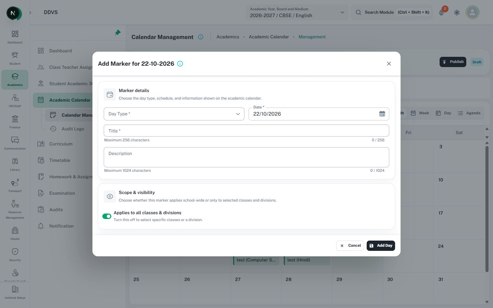

# Checkboxes, switches, radio groups, and decision cards

Use existing MUI controls and the configured theme. These choices do not require a new wrapper.
For business-setting decisions also read [navigation/settings](navigation-settings.md).

| Choice | Use |
| --- | --- |
| Independent selection or consent | Checkbox with FormControlLabel; a group may allow several selections |
| One of several mutually exclusive choices | RadioGroup with a visible group label, Radio, and FormControlLabel |
| A clearly named binary setting | Switch with FormControlLabel; make its on/off consequence and save boundary clear |
| Business behavior with consequences to compare | Existing decision-card pattern with native selection semantics and explanation; not a row of unexplained toggles |

- Bind checkboxes/switches through `checked`, not a string value. Preserve actual null/unknown
  meaning where the domain has more than two states; do not silently coerce it to false.
- Group related choices in FormControl/fieldset with an associated label/legend and helper/error.
  Make the whole label activate its control. Do not nest buttons/links inside a clickable label.
- Use one required marker and the owning Formik/schema validation. Required checkbox groups mean
  the actual minimum/eligible selection contract, not that every option is individually required.
- Use `indeterminate` only for a real mixed aggregate. Define eligible children and scope for bulk
  changes; expanding a group is a separate action from selecting its children.
- A switch inside a submitted form changes its draft until Submit. Do not make it issue an
  immediate API request unless that feature intentionally uses immediate save with progress,
  failure recovery, and a truthful visible state.
- Explain dependent inputs and clear only invalid descendants when the controlling choice changes.
  Keep unrelated values and errors. In a locked form, disable choices and their dependent edits.
- Use normal small-control styling and adequate label hit areas. Do not apply the 30 px button
  height to checkbox/radio targets or invent a new color per choice.

## References and checks

[CalendarDayScopeSection](../../../../src/screens/academic/academic-calendar-management/calendarManagement/components/CalendarDayScopeSection.tsx)
shows a form-owned switch with dependent class/division resets. [HR family fields](../../../../src/screens/hr/employee/employee-form-fields/FamilyFields.tsx)
show address-copy choices; preserve that feature's actual copy behavior.
Use the [local calendar form image](../assets/local-calendar-form.jpg) for switch placement and
the [blank staff form](../assets/local-contact-fields.jpg) for radio placement. Neither proves
indeterminate behavior or complete accessible naming. Check keyboard activation, group names,
error association, mixed/disabled states, saving locks, and retained drafts after failure.
