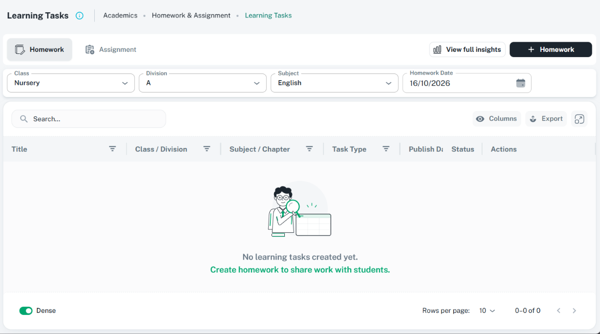

# CustomTabs: ShikshaMitra UI consistency

Use the existing `CustomTabs` for peer content areas within one stable workspace, such as
Homework and Assignment. This is the single component guide; the previous detailed tab rules
in DESIGN.md now route here. Reuse this guide rather than adding another tab rulebook.
Use a [stepper](../../shikshamitra-fe-patterns/references/steppers.md) for a genuinely ordered
workflow, and [table status filters](tables.md#filters-and-status-tabs) for exclusive record states.

## Reference image

The user supplied this Learning Tasks image, inspected on 16 October 2026. It shows Academics /
Homework & Assignment / Learning Tasks, light theme, Homework selected, and an empty table.
Route, CSS viewport, and scale are unknown; image dimensions are not CSS measurements. It is
an image of the selected state, not evidence of tab switching, permissions, or keyboard behavior.

| Reference | Asset | Preserve |
| --- | --- | --- |
| Learning Tasks workspace | [CustomTabs reference](../assets/custom-tabs-learning-tasks.png) | Icon/text tabs left, filled selected tab, insights/create actions right, filters below, stable table toolbar/body/footer |



## Page composition and action ownership

```text
CustomBreadcrumbs: Page Title [Info] | breadcrumb context
Contained workspace row:
  [Icon Homework] [Icon Assignment]                    [Insights] [Create action]
Context filters for the selected panel
Selected content: shared table / relevant workspace
```

- Keep the title/breadcrumb header first and mounted while switching or loading panels.
- Tabs stay left; contextual actions stay right, vertically centered in one contained surface.
  This is the tabbed-workspace alternative to actions in `CustomBreadcrumbs.action`. Render an
  action once, in the same position across equivalent pages; never duplicate it in both rows.
- In this reference, the selected tab determines the create label/action and insights context:
  Homework uses its Homework workflow; Assignment uses Assignment. Preserve actual permissions
  and backend contracts. No empty-state action or tab grants create/view permission.
- Place the selected panel's domain filters below the workspace row; search/Columns/Export/
  Fullscreen remain inside its shared table. Preserve the table's remaining-height flex chain,
  `minHeight: 0`, and scroll ownership. Do not add viewport-height calculations or large spacers.
- Keep related filters, rows, counts, columns, export scope, loading, and empty messages consistent
  with the selected panel. Retain compatible context, clear incompatible criteria, and reset paging
  when scope changes. Never show old-panel rows as if they belong to the new panel.

## Appearance, spacing, and buttons

Use existing theme/component values (spacing unit currently 8 px), not screenshot pixel guesses.

| Element | Standard / source-backed behavior |
| --- | --- |
| Tab/action surface | Full-width paper/theme surface; one spacing owner per group; quiet border/radius/shadow consistent with the module |
| Tab inset | `CustomTabs` scroller owns `p: 1`; do not add another horizontal inset around it |
| Tab items | Existing `px: 2`, `py: 1`, minimum height 44 px, minimum width from theme; retain usable touch targets and natural text growth |
| Between tabs | Component default is zero group gap; the Learning Tasks compact composition uses `flexContainer` gap `1` (8 px). Choose once for the workspace family |
| Icons | Leading meaningful 20 px glyph with visible text; `iconPosition="start"`; use `Iconify` and `GlobalIcons`, not icon-only primary tabs |
| Selected state | Shared filled indicator background, rounded shape, theme contrast, selected text weight; preserve component's dark-theme treatment |
| Unselected state | Quiet paper surface, secondary text/icon treatment; do not make all tabs look selected |
| Action group | Current reference `p: 1`, `gap: 1`, `ml: 'auto'`; no second padded wrapper around the same group |
| Row separation | Compact 1-unit separation between workspace/filter/table surfaces, owned once by the parent composition |
| Labeled actions | Small outlined neutral insights, then small contained inherit create; theme height 30 px, leading GlobalIcons, content-width |

Tabs have at least a 44 px target; the adjacent labeled buttons retain the 30 px compact theme
height. Center them vertically rather than stretching buttons to tab height. Use normal theme
font settings and visible focus; avoid a wildcard font-size rule or `!important` overrides.
The screenshot screen's fixed 160 px create-button width is a local implementation detail,
not a universal requirement. Do not force equal-width tabs unless intentional `fullWidth` is needed.

On narrow screens allow contained horizontal tab scrolling with the shared scroll controls.
Keep text labels. Move/wrap the action group onto its own right-aligned row when needed, followed
by filters and content; do not hide the primary action or introduce document-level overflow.

## Definitions, selected state, and navigation

- Define base tabs as static `{ value: string, label: string }` objects. Values are unique stable
  identifiers, not indexes or translated labels. Keep icon/panel mappings keyed by that value;
  do not maintain parallel arrays whose order can drift.
- Local tab state uses `useTabs` with a valid first/default value. Render MUI `Tab` children with
  `key`, `value`, `label`, and optional meaningful leading icon. The active value must always
  match the visible panel, its actions, and its data scope.
- Meaningful page navigation uses URL-backed state and route constants, preserving reload,
  back/forward, and shareable views. Use normal link semantics when tabs are destinations so
  modifier-click/open-in-new-tab works. Keep one state owner; do not create competing URL and
  local selected values. Validate unknown or permission-ineligible URL values to a valid fallback.
- Mount expensive panel content only when active. Deliberately preserve drafts/context when
  switching; do not lose edits because an inactive panel unmounted silently. Avoid duplicate
  background requests or running every tab's workflow at once without a real requirement.
- Counts are optional and must be current/scope-aware; do not add zeros or decorative badges
  because another module has them. A status count/filter is not automatically a peer panel.
- Supply a meaningful tab-list accessible label, stable tab IDs, `aria-controls`, and matching
  `role="tabpanel"` / `aria-labelledby`. The wrapper does not generate these relationships.
  Preserve arrow-key navigation, selection, focus, Enter/Space activation, and native link behavior.

## Unsaved changes

The current wrapper checks global `isChanges` and uses `window.confirm` before calling `onChange`;
it clears global dirty state after accepted navigation. This is not the custom
[Keep Editing / Discard Changes popup](confirmations.md). Do not show both prompts.

If the owning workspace already preserves one shared form and owns its complete leave guard,
use `guardUnsavedChanges={false}` and let that owner decide whether switching preserves the draft
or requires the shared confirmation. Keep Editing stays on the original tab with all values;
confirmed Discard resets only the correct draft, then commits the pending tab/navigation once.
Do not clear a parent form's dirty state from another tab or commit a URL before the decision.
Real tab links and other navigation paths need the same leave protection, not just `onChange`.
Block conflicting switches while a mutation cannot safely be interrupted.

## Current API and composition example

| API | Actual behavior |
| --- | --- |
| `value`, `onChange(event, value)`, children | Controlled selected state; the wrapper renders MUI Tabs, caller renders Tab children and panels |
| `orientation` | Horizontal by default; vertical aligns items left using shared styles |
| `variant`, scroll props | Inherited MUI Tabs props; theme defaults scrollable with mobile scroll buttons allowed |
| `slotProps` | This wrapper's named style objects: `scroller`, `indicator`, `tab`, `selected`, `scrollButtons`, `flexContainer`; inspect before assuming standard MUI slot component props |
| `guardUnsavedChanges` | True by default; disable only under the complete owning-form guard described above |
| `sx` | Intentional layout overrides; do not use for arbitrary duplicate padding or a new visual theme |
| Panels/URL/actions | Owned by the feature; no `tabs`, `items`, `panels`, `actions`, or routing prop exists on this wrapper |

```tsx
import { useId } from 'react';
import { Box, Tab } from '@mui/material';
import { CustomTabs } from 'src/components/custom-tabs';
import { useTabs } from 'src/hooks/use-tabs';
import { Iconify } from 'src/components/iconify';
import { GlobalIcons } from 'src/utils/icons';

// Local-state example. Durable workspace navigation instead uses its URL state owner.
const TABS = [
  { value: 'homework', label: 'Homework' },
  { value: 'assignment', label: 'Assignment' },
];
const TAB_ICONS = { homework: GlobalIcons.notebook, assignment: GlobalIcons.documentIcon };

function TaskPanels() {
  const tabs = useTabs(TABS[0].value);
  const prefix = useId();
  return (
    <>
      <CustomTabs value={tabs.value} onChange={tabs.onChange}
        aria-label="Learning task views" slotProps={{ flexContainer: { gap: 1 } }}>
        {TABS.map((tab) => (
          <Tab key={tab.value} value={tab.value} label={tab.label}
            id={`${prefix}-${tab.value}-tab`} aria-controls={`${prefix}-${tab.value}-panel`}
            icon={<Iconify icon={TAB_ICONS[tab.value as keyof typeof TAB_ICONS]} width={20} />} />
        ))}
      </CustomTabs>
      {TABS.map((tab) => (
        <Box key={tab.value} role="tabpanel" id={`${prefix}-${tab.value}-panel`}
          aria-labelledby={`${prefix}-${tab.value}-tab`} hidden={tabs.value !== tab.value}>
          {tabs.value === tab.value ? renderPanel(tab.value) : null}
        </Box>
      ))}
    </>
  );
}
```

Use the feature's real `renderPanel` implementation.
The icon mapping demonstrates available GlobalIcons keys; add a missing semantic key centrally
if the exact product glyph is needed. It does not authorize changing records or permissions.

## Component relationships and checks

| Concern | Existing source / guide |
| --- | --- |
| Shared tabs and inline types | [CustomTabs](../../../../src/components/custom-tabs/custom-tabs.tsx), [exports](../../../../src/components/custom-tabs/index.ts) |
| Local state | [useTabs](../../../../src/hooks/use-tabs.ts); `value`, `setValue`, and `onChange`; no built-in URL persistence |
| Theme and icons | [Tab theme](../../../../src/theme/core/components/tabs.tsx), [GlobalIcons](../../../../src/utils/icons.ts), [Iconify](../../../../src/components/iconify/iconify.tsx) |
| Header/filter/table | [Header guide](page-headers.md), [table guide](tables.md), [select guide](custom-select.md), [date guide](date-pickers.md) |
| Source screen | [Learning Tasks](../../../../src/screens/academic/homework-assignment-management/homeworkCreation/index.tsx); source example, not an exemption from current rules |
| Form safety | [Confirmation](confirmations.md), [sections](sections.md); form/view sections remain consistent inside tab panels |

Verify each valid/default/unknown value; selected style and panel relationships; contextual actions
and permissions; counts/filter/table scope; URL reload/back/forward/modifier-click when applicable;
dirty switch Keep Editing/Discard; busy locks; keyboard/focus; narrow scrolling; both themes;
and loading/empty/error states. Documentation checks links/assets and whitespace; UI changes
also need focused checks and the required in-app browser smoke test.

## Inconsistencies

The current Learning Tasks source uses literal icon IDs, broad `13px !important` styling, a
fixed create width, and does not supply explicit tab/panel IDs. URL switching alone does not
establish native link behavior. The wrapper's guard still uses a native browser confirmation.
These are implementation differences to resolve when touching runtime UI; no runtime fix is
claimed here. Viewport matching, actual keyboard/guard behavior, both themes, tab-to-panel
transitions, and the reference's complete empty-state interaction remain Unverified.
