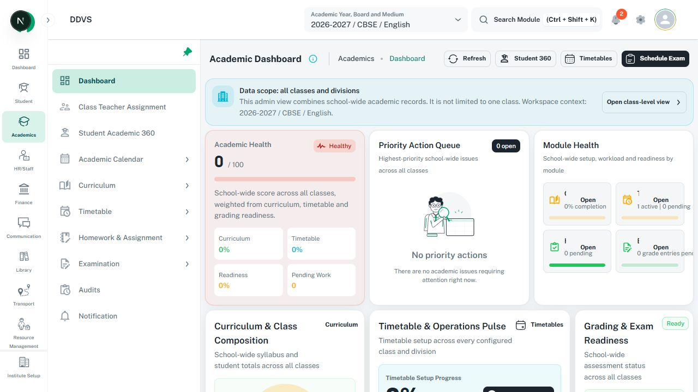

# Dashboards, metric cards, and charts

Use the owning dashboard family rather than one universal card grid. Read
[dashboard docs](../../../../docs/dashboard/README.md),
[DESIGN.md Chart](../../../../DESIGN.md#22-chart), [status labels](status-labels.md), and
[empty/loading states](empty-loading-states.md). Finance-sensitive widgets also require the
Finance Engineering Constitution linked by frontend AGENTS.md; a visual guide cannot redefine money.

## Existing component references

| Surface | Current source / boundary |
| --- | --- |
| Main command center | [MainDashboard](../../../../src/screens/mainDashboard/main-dashboard.tsx), [DashboardShell](../../../../src/screens/mainDashboard/dashboard-shell.tsx), [template view](../../../../src/screens/mainDashboard/dashboard-template-view.tsx) |
| Widget and region | [DashboardWidgetCard](../../../../src/screens/mainDashboard/dashboard-widget-card.tsx), [DashboardZone](../../../../src/screens/mainDashboard/dashboard-zone.tsx), [widget registry](../../../../src/screens/mainDashboard/dashboard-widget-registry.ts) |
| Existing module metric cards | [DashboardSummaryCard](../../../../src/components/dashboard/summary-card.tsx), [quick actions](../../../../src/components/dashboard-quick-action/index.tsx); inspect the module caller rather than replacing its whole family |
| Configurable section ordering | [CustomizableView](../../../../src/components/customizable-view/index.tsx): `sections`, `setSections`, `dashBoardSections`; current drag composition is not a universal dashboard requirement |
| Charts | [Chart](../../../../src/components/chart/chart.tsx), [types](../../../../src/components/chart/types.ts), [useChart](../../../../src/components/chart/use-chart.ts) |

## Information and state rules

- Show page identity first, then real period/scope and freshness when available. Prioritize useful
  metrics, actionable issues, and drilldowns for the user's role; do not invent metrics to fill cards.
- Keep equivalent cards consistent within their family: label, value/unit, meaningful comparison,
  status, and optional drilldown. Missing/unavailable is distinct from a real zero.
- Derive status and displayed value from the same authoritative result. Do not copy contradictory
  snapshot labels such as Healthy beside an unexplained zero score as a valid semantic mapping.
- Distinguish a fully clickable card from a card containing separate actions. Use actual Link/Button
  semantics, keyboard focus, accessible names, and valid destinations. Do not nest interactive targets.
- Preserve existing widget-registry permissions and safe drilldown rules. Do not expose a link or
  count merely because its tile can be rendered. A screenshot never proves permitted data scope.
- Each query region owns loading, stale refresh, empty, partial error, and retry without unmounting
  the shell or resetting unrelated filters. A successful metric does not imply every zone loaded.
- Follow actual module density and neutral surfaces. Use accent for meaningful state/series, not
  an arbitrary color per card. Keep value labels readable and long titles contained on phones.

## Chart rules and actual API

- Use the shared `Chart` and `useChart`; it accepts ApexCharts-style `type`, `series`, `options`
  and currently translates them to Highcharts. Do not wire a feature directly to an assumed engine.
- Preserve stable series identities, meaningful axis names/units, date/number formatters, and
  consistent colors for the same series. Labels/legend or patterns supplement color.
- Verify supported types against current types/translator. Do not infer support from a screenshot
  or from the chart library's full external feature list.
- Tooltips identify the actual series/value/period and remain within the viewport. Keep key results
  available as readable text or an equivalent table when pointer interaction is unavailable.
- Empty arrays, all-zero data, missing samples, loading, and request errors have distinct meaning.
  Do not substitute fabricated data or treat zero series as an API failure.
- Use the owning container's responsive dimensions and bounded overflow. Preserve legend access,
  keyboard/drilldown behavior where provided, and loading geometry; do not hide data to make it fit.

## Image and checks

This is module-family composition evidence. Its zero-score/Healthy combination is a recorded
semantic mismatch, not a correct status reference. It is not the main command-center template.
See [capture metadata](image-references.md#local-app-captures-22-october-2026).
Check role/period/scope changes, zero versus missing, truthful freshness, partial failure/retry,
valid drilldowns, labels/units, chart alternatives, both themes, and responsive containment.
