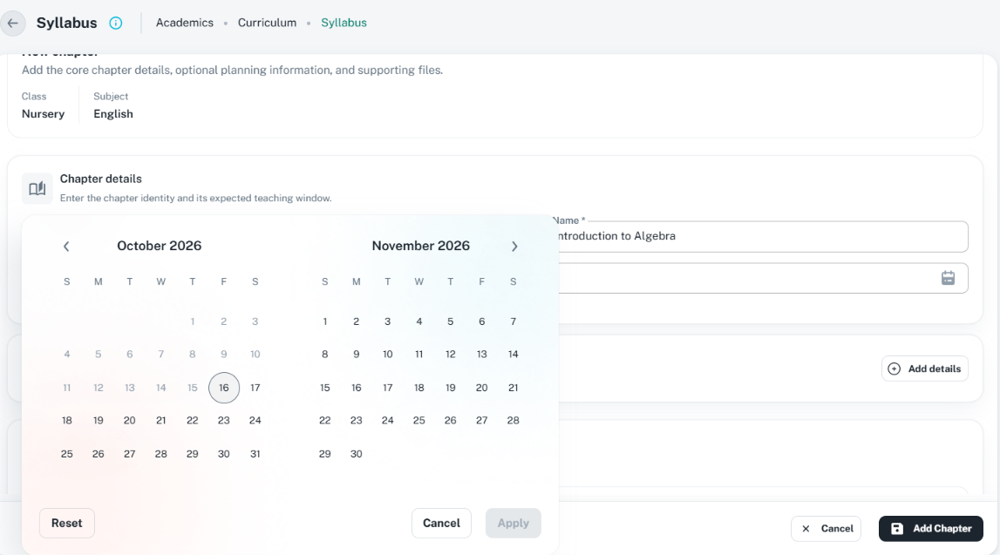

# CustomDateRangePicker: consistent date ranges

Use for a meaningful start/end interval. Follow [date validation](date-pickers.md),
[field/section rules](sections.md), and the owning dialog/drawer/[page-form](page-forms.md) guide.
Two dates do not turn the component into a generic dropdown.

## Reference images

The user supplied Syllabus chapter-form images, inspected on 16 October 2026. Two attachments
depict the same open calendar; one canonical asset represents that view. The images show light
theme; browser viewport, scale, and source route are unknown. Do not infer allowed dates from
the displayed October/November 2026 months or hardcode the pictured academic-year boundaries.

| Reference | Linked asset | Preserve |
| --- | --- | --- |
| Closed range field in page form | [Syllabus page form](../assets/page-form-syllabus.png) | Full-width Expected teaching dates input, calendar icon, useful academic-year helper, section grouping |
| Open two-month range | [Range picker](../assets/date-range-picker-open.png) | Anchored calendar, two months on wide space, navigation, Reset/Cancel/Apply, disabled Apply until valid selection |

## Field, popup, and validation

- Keep a persistent sentence-case label and clear `DD/MM/YYYY - DD/MM/YYYY` format. Set
  `dateFormat="DD/MM/YYYY"` explicitly; the underlying RangeField default is currently
  `MM/DD/YYYY`, while its placeholder suggests day/month.
- Required ranges have exactly one visible `*` and accessible required meaning. Wrap the range
  field/control in `ShakingTextField` with touch/submission-gated form errors, as in the
  [shared rule](sections.md#shared-required-field-wrapper). Keep both endpoint errors accounted
  for; do not hide an invalid end date when showing the first available message.
- Show a useful helper with the actual allowed interval, or the relevant error. Keep section
  spacing `2`, small full-width field shape, calendar adornment, and accessible field help where
  needed. The range popup must fit above the parent footer without clipping or closing the form.
- Use the existing desktop Popover and compact mobile Dialog, not an additional local calendar.
  The wrapper defaults to two calendars at desktop `md` and one otherwise. In a narrow drawer,
  choose a supported single-calendar/mobile layout based on usable space, not only browser width.
- Calendar controls use shared small buttons and `GlobalIcons` when implementing: Reset/reset,
  Cancel/cancel, Apply/tick. The form's footer Submit is separate; calendar buttons never submit
  or cancel the parent form. Preserve both controls' focus/dismissal boundaries.

| Validation | Rule |
| --- | --- |
| Empty required range | Both endpoints required by the form schema; show error after touch/submit |
| Optional interval | Either both null or a complete valid interval, unless the actual API supports open-ended ranges |
| Endpoint parsing | Real valid Dayjs dates; reject impossible/partial typed dates and inconsistent format |
| Order | End is on/after start, including same-day ranges when allowed; validate externally supplied values too |
| Bounds | Both endpoints obey actual inclusive min/max and feature-specific past/future rules |
| Blocked dates | Apply the real date restrictions; if every day in an interval must be valid, validate the interior too, not just endpoints |
| Submit | Revalidate form/schema even if the picker disables invalid cells; do not submit a stale previous valid range |

Do not globally add `disablePast` because the screenshot is a future schedule; keep create/edit
and historical-date policy specific to the owning contract. Use Dayjs/null tuples while editing;
serialize at the API boundary without changing date-only values through unintended UTC conversion.

## Current API and Apply/Cancel semantics

Inspect [component](../../../../src/components/custom-date-range-picker/custom-date-range-picker.tsx),
[types](../../../../src/components/custom-date-range-picker/types.ts),
[RangeField](../../../../src/components/custom-date-range-picker/RangeField.tsx),
[state hook](../../../../src/components/custom-date-range-picker/hooks/useDateRange.ts), and
[validation hook](../../../../src/components/custom-date-range-picker/hooks/useRangeValidation.ts).

| API / action | Actual current behavior |
| --- | --- |
| Values | `value`/`defaultValue`: `[Dayjs \| null, Dayjs \| null]`; `onChange(range)`, optional `onAccept(range)` |
| Presentation | `variant` input/calendar, `mode` desktop/mobile/static declaration, `calendars`, `singleInput`, labels, `dateFormat`, `referenceDate` |
| Restrictions | `minDate`, `maxDate`, `disablePast`, `disableFuture`, `disableWeekends`, `shouldDisableDate` |
| Calendar selection | Draft range is kept internally until Apply (unless `closeOnSelect`); clicking an earlier second date sorts calendar endpoints |
| Apply | Commits calendar draft and calls callbacks; currently disabled for missing endpoints or endpoint restriction errors, not a complete replacement for schema/order/validity checks |
| Cancel / popup dismissal | Reverts calendar draft to the last committed range; does not discard the parent form |
| Reset | Currently restores the committed range; it does not clear both dates. Do not describe it as Clear |
| `allowManualInput` | Optional single-field typing; strict format parsing and validation; edits call onChange immediately, so popup Cancel does not undo already committed typing |
| Feedback | `error`, `helperText`, `readOnly`, `disabled`; internal manual-input errors may take precedence over helper text |

`required` and `name` are declared/destructured but not forwarded to RangeField; `slotProps.field`
and most declared slots are also not wired to the trigger. Passing `required` alone therefore
does not prove a visible/accessibly required field. The Syllabus source passes it while the
pictured field has no star. Extend the shared component to forward these semantics before
claiming implementation compliance; do not invent a working `fieldInfo`/`onBlur` prop or paper
over the missing accessible state with a literal star. `RangeField` already uses small size.

Manual invalid typing clears committed values and reports an internal error so an old valid
range is not silently submitted. The owner must still validate required/optional completeness,
expose a visible error, and keep wrapper/control feedback synchronized; the current public API
does not expose every internal draft error separately.

## Integration references and checks

The current [ChapterDetailsSection](../../../../src/screens/academic/course-management/syllabusManagement/components/ChapterDetailsSection.tsx)
shows range bounds, helper text, and `ShakingTextField`. Its
[schema](../../../../src/screens/academic/course-management/syllabusManagement/validationSchema.ts)
defines the real requiredness/bounds; it is not a blanket policy for other modules.

Confirmed gaps: required/name forwarding above; picker action buttons currently omit explicit
small size, icons, and non-submit type; some declared customization/mode options are not fully
implemented. Do not assume a type declaration alone means runtime support. Check no initial
false error, required/malformed/partial/reversed ranges, inclusive boundaries, all selected days
when required, calendar Apply/Cancel/Reset, manual input, changed parent context, create/edit
rules, popup focus/Escape, narrow drawers, and no parent-submit activation. Runtime validation,
accessibility, mobile, and both-theme matching remain Unverified by this documentation task.
