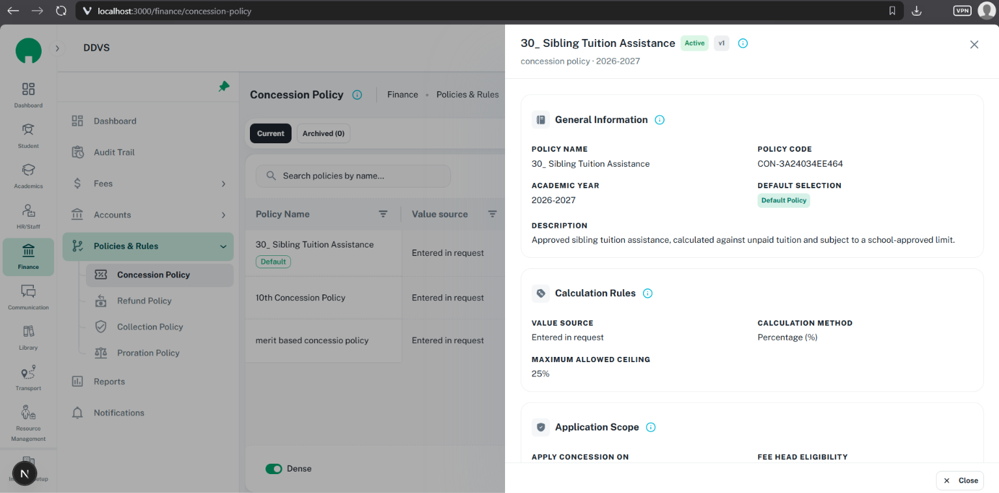

# Drawers: ShikshaMitra UI consistency

Use for contextual create/edit forms and record views that preserve the underlying table.
Read [sections.md](sections.md) first: form and view drawers share the same section structure,
header typography, leading icons, info controls, field terminology, and spacing. Read the
[form guide](form-dialogs.md) for validation and the [confirmation guide](confirmations.md)
for focused decisions. This replaces the previous compact drawer guide.

Read-only drawers follow [the required Policy-view anatomy](detail-pages.md#required-policy-view-anatomy-and-info-controls):
record-header info plus adjacent info on every meaningful section. Supply their actual help props;
using shared headers/cards alone does not automatically render the icons.

Use [button-family.md](button-family.md) for shared Submit/Cancel/Close APIs, small sizing,
leading icons, action spacing, and loading/disabled locks. Keep this guide's drawer footer insets.

Use [NumericFormatCustom](numeric-format-custom.md) for amounts, percentages, and counts,
including required markers, info/helper text, validation, and formatNumber in saved details.

Use [CustomUpload](custom-upload.md) for attachment types/size, required/helper/error treatment,
progress, preview/removal, and corresponding read-only attachment sections.

Use [empty and loading states](empty-loading-states.md) for scoped messages, initial section
skeletons, and FormBusyRegion save locks; preserve the drawer header/body/footer boundaries.

## Reference images

Both user-supplied images were visually inspected on 16 October 2026. They show light-theme
Concession Policy drawers at `localhost:3000/finance/concession-policy`, over the parent table.
File dimensions include browser chrome; actual CSS viewport/scale are unknown. No annotations
were supplied, and only the visible portion of the body is shown.

| Reference | Asset | Preserve |
| --- | --- | --- |
| Create Concession Policy | [Form drawer](../assets/drawer.png) | Title, Draft badge, info, top-right close; sectioned fields; required markers; fixed Cancel/Submit footer |
| Saved policy details | [View drawer](../assets/drawer-view.png) | Record title, status/version, info, close; corresponding sections with real saved details; fixed Close footer |




Use the form's restrained section-title styling for both modes. The view's heavier headings and
uppercase field labels are differences to correct, not a new visual standard. Keep its useful
saved details. Neither screenshot defines permissions or the complete form schema.

## Drawer anatomy

For an ordered multi-step form inside the drawer, also follow [stepper-forms.md](stepper-forms.md).
Reuse its state, stage validation, sections, and single shared footer beneath the drawer header;
do not add a second form/scroll region or competing Submit footer.

```text
Fixed header: Task / Record Title [status] [version if useful] [Info]       [Close X]
Scrollable body:
  [Leading icon] General Information [Info]
  [Leading icon] Calculation Rules [Info]
  [Leading icon] Application Scope [Info]
Fixed footer:
  Form:                                                  [X Cancel] [Save Submit]
  View:                                                             [X Close]
```

Every information/field group belongs in a meaningful section. Use the same names and order in
the view and form for equivalent data. Other domains use their own meaningful groups rather than
copying policy names. Do not add summaries, balance previews, completion checklists, repeated
descriptions, or generic policy advice. Preserve real restrictions and required transaction-review
content. Use a dedicated page when the record needs independent navigation or continuous comparison.

## Header and titles

- Use human-readable Title Case for task/section titles, matching the images: `Create Concession
  Policy`, `Edit Concession Policy`, `General Information`. Preserve user-entered record names
  exactly in view titles. Do not transform visible titles into code identifiers such as
  `generalInformation`.
- Order the header as title, relevant status, useful version badge, information icon, with the
  close icon anchored at the far right. If no badge exists, help follows the title. Use one help
  icon for drawer context; section and field help stay with their own content.
- Supply concise, useful drawer help through an accessible tooltip/popover. Do not repeat the
  title, add a second info icon for the same message, or show a long subtitle by default.
  Keep a short type/year identity line only when it adds necessary distinct context.
- Drawer title follows the current `h6` theme; section titles use the shared `subtitle1`/600
  treatment from [sections.md](sections.md). Preserve wrapping and semantic heading hierarchy.
- Close is a real icon button with a specific accessible name, such as `Close Create Concession
  Policy`; use `GlobalIcons.cancel`. Its close callback must be the same guarded close path as
  footer Cancel, Escape, and backdrop dismissal. Do not wire any of them directly to reset/close.

## Layout and spacing

Use the module's established MUI Drawer composition and theme. The Finance header is a useful
feature reference, not a universal shared CRUD drawer API or reason to import Finance into HR.

| Area | Standard / source-backed reference |
| --- | --- |
| Panel | Right anchored, column flex, full available height, `maxWidth: '100%'`; restrained backdrop |
| Width | Match equivalent tasks; reference form uses `{ xs: '100%', sm: 'min(840px, 96vw)' }`, view uses `min(760px, 92vw)`; these are Finance examples, not a universal size |
| Header | `px: { xs: 2, sm: 3 }`, `py: 2`; border below; `flexShrink: 0` |
| Header identity | Title/badges/help `spacing={1}`; close stays reachable as text wraps |
| Body | `flex: 1`, `minHeight: 0`; one scroll owner; padding `{ xs: 2, sm: 3 }` once |
| Sections | `Stack spacing={2}`; card padding and field grids follow [sections.md](sections.md) |
| Footer | Same responsive horizontal inset as header/body, `py: 1.75` in the current form reference; paper surface and subtle top border; `flexShrink: 0` |
| Footer actions | Right aligned, `spacing={1}`, vertically centered; content-width small buttons; Cancel before Submit |

Spacing uses current 8 px theme units. Header and footer remain stationary while the body scrolls.
Avoid nested ordinary-field scrollbars, viewport-height subtraction, and arbitrary blank spacers.
On narrow screens, use full width, one-column fields, wrapping header content, and reachable footer
controls without document overflow. Do not shrink text or controls to make a desktop layout fit.

## Form fields and footer

- Use the [section field rules](sections.md#fields-required-markers-labels-and-help): persistent
  sentence-case labels, exactly one `*` for genuinely required editable fields, useful helpers,
  inline errors, and field help where choices need explanation. Keep terminology the same in
  form and view. The form's Value source is the reference for field-specific info placement.
- Form state and validation stay with the owning form/hook. Dependent fields and required flags
  follow the actual contract, not the screenshot. Preserve numeric input/formatting contracts.
- Every required editable field/control uses the shared `ShakingTextField` wrapper around its
  existing input and error group. Follow [the required-field rule](sections.md#shared-required-field-wrapper)
  for touch/submit gating, matching wrapper/input error state, and avoiding duplicate wrappers.
  Keep field shape, small sizing, required marker, and visible helper/error text unchanged.
- Cancel: small, `variant="outlined"`, inherit/neutral, `type="button"`, leading
  `<Iconify icon={GlobalIcons.cancel} />`, wired to the guarded close path.
- Submit: small, `variant="contained"`, inherit/neutral, `type="submit"`, leading
  `<Iconify icon={GlobalIcons.submit} />`. Keep the label `Submit` for ordinary create/edit.
  In light mode it has the standard black/dark fill and white text shown in the reference.
  Use theme tokens/contained inherit so dark mode preserves contrast; do not hardcode black/white.
- Both buttons use leading icons, not star glyphs. Theme owns the 30 px small-button height,
  radius, font, and icon/text padding; do not add local button heights or decorative shadows.
- All drawer, section, field-help, and footer icons come from `GlobalIcons`. Reuse meaningful
  existing keys; add missing semantic keys centrally in an implementation task. Do not invent
  keys or paste raw icon strings into new screen code.
- Use `SubmitButton` when its API fits. `CancelButton` is outlined but currently has no disabled
  prop; use a supported MUI Button for busy locking or extend the shared wrapper. Do not pass
  unsupported props to make an example appear complete.

## View drawer and opening from a table

- A table's supported record link/view action opens the corresponding view with the correct
  record identity, subject to the feature's permissions. Preserve active filters, page, status,
  and table scroll context. Provide keyboard activation; a mouse-only `handleRowClick` is insufficient.
  Row action clicks must not also trigger row view navigation.
- Read-only content uses the same section names, order, icons, help, heading size/weight, and
  padding as the form. Render values with labels, not disabled inputs. Keep saved description,
  source/method/value, scope, useful code/year/version, and relevant settings in their sections.
- Keep value units and enum terms consistent. Preserve meaningful zero/false, long notes, and
  permitted details even if not editable. Do not change stored names or amounts to match a screenshot.
- Use the same sentence-case field labels; remove view-only all-caps/extra-bold styling. Do not
  make body values bold because the section title is semibold. See [section parity](sections.md#form-to-view-parity).
- The footer uses one outlined `Close` button with `GlobalIcons.cancel`. No Submit, required
  markers, or unsaved-change confirmation is needed for a purely read-only panel. Separate
  consequential operations still follow their own confirmation rules.
- Fetching details shows content-shaped loading; an error shows accurate retry content. Do not
  present partial/previous-record data as a completed view. Close remains usable during a normal
  read-only fetch unless a blocking mutation makes dismissal unsafe.

## Unsaved changes and close protection

Use one close guard at the owning form boundary and one actual dirty-state source, such as
`formik.dirty`. Changes include inputs, selectors, toggles, collections, and uploads. Returning
all values to the original baseline should remove dirty state; loading initial data is not an edit.

| Close attempt / state | Required result |
| --- | --- |
| Clean form: Cancel, header X, Escape, backdrop, supported leave/navigation | Close once; clean up the session; restore launching focus |
| Dirty form: any of those paths | Keep drawer and values mounted; show the existing unsaved-changes confirmation |
| Confirmation `Keep editing` or safe dismissal | Close only confirmation; preserve all input and return focus to form |
| Confirmation `Discard changes` | Explicitly reset draft/edit identity, close confirmation/drawer, and restore focus; do not save |
| Blocking save/submit | Lock inputs, Submit, Cancel, X, Escape, backdrop, and conflicting navigation; show progress; no duplicate request or discard race |
| Failed save | Keep drawer/values and accurate errors; release busy lock; retry or guarded cancellation remains available |
| Successful save | Reset baseline/session and close or transition per the existing workflow; do not immediately trigger a discard popup |

Use `ConfirmDialog` with a focused `Discard Unsaved Changes?` title and concise consequence.
The safe action is `Keep editing`, the explicit destructive action is `Discard changes`; never
use generic Yes/No. Keep the confirmation's backdrop from discarding anything. Do not add a
second competing browser/native confirmation if the form already owns this guard.
Only the confirmed discard branch resets values. Do not clear the form before showing the popup.

## Components and implementation references

| Concern | Existing source / related guide |
| --- | --- |
| Drawer styling | [MUI drawer theme](../../../../src/theme/core/components/drawer.tsx) |
| Form composition and close wiring | [ConcessionPolicyDrawer](../../../../src/screens/finance/policies/components/ConcessionPolicyDrawer.tsx), [form hook](../../../../src/screens/finance/policies/hooks/useConcessionPolicyForm.ts) |
| Header | [FinancePolicyDrawerHeader](../../../../src/screens/finance/policies/components/FinancePolicyDrawerHeader.tsx); title/titleId, description/helpText, badges, onClose, disabled; feature-owned reference |
| View | [FinancePolicyDetailsDrawer](../../../../src/screens/finance/policies/components/FinancePolicyDetailsDrawer.tsx), [detail guide](detail-pages.md) |
| Sections | [Section guide](sections.md), [shared card](../../../../src/components/form-section-card/index.tsx), [detail primitives](../../../../src/components/detail-view/index.tsx) |
| Footer | [Current footer](../../../../src/screens/finance/policies/components/concession/ConcessionFooterActions.tsx), [SubmitButton](../../../../src/components/submit-button/index.tsx), [CancelButton](../../../../src/components/cancel-button/index.tsx) |
| Confirmation | [ConfirmDialog](../../../../src/components/confirm-dialog/confirm-dialog.tsx), [types](../../../../src/components/confirm-dialog/types.ts), [guide](confirmations.md) |
| Icons and scrolling | [GlobalIcons](../../../../src/utils/icons.ts), [Iconify](../../../../src/components/iconify/iconify.tsx), [Scrollbar](../../../../src/components/scrollbar/scrollbar.tsx) |

`ConfirmDialog` supports `cancelText`, `disableCancel`, and `disableBackdropClick`; pass the
actual action node and guarded callbacks. It has no `onDiscard` prop. `FormSectionCard` is
presentation only. Do not copy the app-settings drawer as a CRUD shell or invent a universal
drawer component that the project does not contain.

## Verification and inconsistencies

Check title/status/help/X order; focus and labels; single body scroll; consistent section style
in form/view; required markers; helpful field info; footer alignment/icons/variants; clean versus
dirty Cancel/X/Escape/backdrop; Keep editing versus Discard; save failure/success; opening another
record; mobile keyboard; long labels; both themes; no extra advice/summary cards. For runtime
changes run focused checks and the required in-app browser smoke test; documentation-only work
checks links/assets, skill structure, and whitespace.

Confirmed source differences: view section headings force 700 and labels uppercase/800, while the
form uses 600; some section/help/close icons are literal strings rather than `GlobalIcons`. The
current form footer chooses Edit's icon during editing; this standard uses `GlobalIcons.submit`
for Submit in either mode. These need implementation changes before claiming visual consistency.
The existing form already routes Cancel/X/Escape/backdrop through its dirty-close handler;
full navigation coverage, keyboard behavior, font matching, mobile, and unseen sections remain
Unverified. This documentation task does not claim the running application has been changed.
