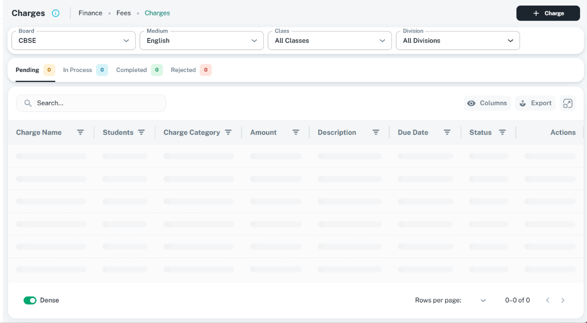

# Empty and loading states: ShikshaMitra UI consistency

Use the existing EmptyContent, SearchNotFound, table skeletons, MUI Skeleton, and FormBusyRegion
for their distinct jobs. This guide applies to [tables](tables.md), [drawers](drawers.md),
[dialogs](form-dialogs.md), and [page forms](page-forms.md), including corresponding view details.
Keep the owning shell, [sections](sections.md), filters, and navigation stable as content changes.

## Visual references

The following supplied light-theme images were inspected on 16 October 2026. CSS viewport and
scale are unknown; they establish the shown layout, not live request timing or accessibility.

| State | Existing asset | Preserve |
| --- | --- | --- |
| Successful empty table | [Learning Tasks](../assets/custom-tabs-learning-tasks.png) | Illustration and complete message group centered in table body; header, filters, toolbar, columns and footer remain mounted |
| Initial table loading | [Charges](../assets/table-filters-tabs.png) | Content-shaped skeleton rows aligned with columns; stable context, toolbar, headings and pagination layout |




The empty reference's green guidance does not prove it is an interactive control. Use a real
accessible button/link when an action is offered. Pending zero counts in the Charges image do
not establish a successful empty result. SearchNotFound and FormBusyRegion have no supplied
state-specific image; their visual matching remains Unverified.

## Choose the state from actual request and scope data

| State | Presentation | Example message / next action |
| --- | --- | --- |
| Prerequisite missing | Scoped instruction; do not issue an invalid or unscoped query | `Select a class to view students.` |
| Initial fetch / different record or scope | Content-shaped skeleton and labeled busy region | `Loading student details…`; no completed-empty message |
| Successful first-use empty | EmptyContent in the owning content region | `No learning tasks created yet.` / useful guidance; permitted Create action if appropriate |
| Search returned no matches | SearchNotFound for a compact search region, or the shared table's filtered-empty state | Retain query; `No results found for “algebra”.` / Clear Search |
| Filters/status/scope returned no matches | Scoped empty message; retain selected criteria | `No charges match the selected filters.` / Clear Filters, or change scope when valid |
| Same-scope refresh with valid visible data | Retain valid content and add a thin labeled progress indicator in the owner | `Refreshing charges…`; no full empty screen or loss of input |
| Blocking form save | FormBusyRegion around current fields plus loading primary action and external locks | `Saving policy…`; prevent repeat submit and conflicting edits |
| Read request failed | Useful inline error and supported Retry action | `Unable to load student details. Try again.`; never No Data |
| Save failed | Keep entered values, release busy lock, show field/form errors | Actual safe error and retry path; do not replace the form with EmptyContent |
| Access unavailable | Owning feature's forbidden/restricted presentation | Explain access accurately; never imply the dataset is empty |

Only show successful empty after a completed request for the current scope. Do not use an
empty array default to infer success before fetching, or display the previous record as the
newly selected record. A saved record with one missing optional value uses its normal missing
value placeholder, not a whole-section empty illustration. A new create form is not an empty state.

## Existing APIs and boundaries

| Component | Source / supported contract |
| --- | --- |
| EmptyContent | [Implementation](../../../../src/components/empty-content/empty-content.tsx); named export. `title` ReactNode, `description` string, `action` ReactNode, `imgUrl`, `filled`, `slotProps.img/title/description`, and inherited Stack props. Default title is No data |
| SearchNotFound | [Implementation](../../../../src/components/search-not-found/search-not-found.tsx); named export. `query` and Box props. Fixed copy: empty query shows Please enter keywords; nonempty query shows Not found and query guidance. No title/description/action/icon prop |
| MUI Skeleton | Use supported text, circular or rounded variants matching the eventual content. No separate universal project Skeleton wrapper is assumed |
| TableBodyLoadingRows | [Implementation](../../../../src/components/customizabaleTable/components/TableBodyLoadingRows.tsx); internal table component. Receives columns, columnVisibility, dense, rowsPerPage; renders at most 10 rows |
| FormBusyRegion | [Implementation](../../../../src/components/form-busy-region/index.tsx); named export. Only `busy`, optional `label` (default Saving…), and `children`; no sx, progress, onCancel or fullscreen prop |
| LoadingScreen | [Implementation](../../../../src/components/loading-screen/loading-screen.tsx); Box props plus optional portal. Region with a neutral LinearProgress, not a form lock or fixed overlay |
| SplashScreen | [Implementation](../../../../src/components/loading-screen/splash-screen.tsx); fixed application splash, portal defaults true. Reserve for the established application bootstrap, not ordinary table/form requests |

Pass specific messages rather than using generic No Data/Loading everywhere. SearchNotFound's
empty-query prompt is appropriate only when typing is required; a picker with zero available
options needs an accurate scope/prerequisite message instead. Use supported owning popup copy
or extend the shared API when fixed wording cannot describe the state; do not invent props.

## Messages, illustration, icons, and spacing

- Write short sentence-case state messages naming what is missing/loading. Add one useful
  explanation or next step only when it adds information. Do not show raw exception text,
  stack traces, indefinite Please Wait copy, dummy data, or repeated explanatory paragraphs.
- Keep the shared [StudentSearchingIllustration](../../../../src/assets/illustrations/student-searching-illustration.tsx)
  for normal EmptyContent. It is decorative and theme aware. A contextual imgUrl is optional,
  not a reason to create new artwork for each state. Do not add a second large search/warning
  icon beside the illustration or show a celebratory success icon for an error/empty result.
- Action icons use Iconify and existing GlobalIcons keys: addIcon for creation, resetFilter for
  criteria reset, refresh for Retry/Refresh. Follow [button-family.md](button-family.md): small
  30 px labeled buttons, leading icons, relevant variants, and genuine disabled/loading behavior.
  No action should exist solely to decorate the message.
- Offer Create only for a valid, permitted first-use workflow. A search/filter miss offers
  clearing the relevant criteria, not another Create. Clear Search must preserve unrelated
  filters; Clear Filters must preserve unrelated input unless the action explicitly clears both.

| Boundary | Source-backed spacing / presentation |
| --- | --- |
| Empty group | Center the complete illustration/title/help/action group in its available content region; no fixed viewport height or arbitrary blank spacers |
| EmptyContent base | Horizontal padding `3` (24 px), illustration max-width 160 px, title top margin `1`, optional description top margin `1`; theme colors/typography |
| Table empty | TableEmptyState owns sticky visible-body width and `p: 0`; do not add another empty card or outer padding. Illustration max-width is 72/160 px for xs/sm; filtered-empty hides it on xs |
| Empty action | EmptyContent does not add action spacing automatically. Use a supported action node with an intentional top gap; shared table reset uses `mt: { xs: 1, sm: 2 }` |
| SearchNotFound | Compact body2 guidance, centered nonempty-query group, heading bottom gap `1`; surrounding search/list owns padding. Do not insert a large page illustration in an option list |
| Section skeletons | Match normal section/field padding and grid; section/field spacing `2` (16 px), heading/icon row spacing `1`. Skeleton dimensions follow expected content, not an unrelated screenshot |
| Table skeletons | Shared cells use `px: 2`, dense `py: 1.5` or regular `py: 2`, text width 100%, and 24 px circular placeholder for an expand column |
| Busy overlay | FormBusyRegion owns a paper-colored 0.8-alpha overlay, centered 24 px spinner and body2 status with spacing `1`; do not add a competing spinner/overlay inside that same body region |

Preserve the existing theme's EmptyContent title/description styling; its implementation uses a
16 px title and caption description. Do not force screenshot-green helper copy across all states.
Use filled only when a standalone empty surface needs it; avoid a second dashed card inside an
already bounded table or section. Wrap long queries/messages without breaking narrow layouts.

## Table integration

Use CustomizableTable's actual props: `isLoading` for skeleton rows, `errorContent` for a
recoverable error region, and `noDataText` for the completed unfiltered-empty message. Its
internal [TableEmptyState](../../../../src/components/customizabaleTable/components/TableEmptyState.tsx)
detects table search/column criteria and composes clear actions. Domain filters/statuses are
owned by the feature; supply the correct scoped state rather than assuming the table detects them.

- The internal body checks errorContent before isLoading, then empty data. Do not leave stale
  errorContent set if a retry is meant to show loading. An error is never a successful empty result.
- noDataText is rendered inside EmptyContent.title, a Typography span. Prefer plain text or
  valid inline phrasing. Do not pass another EmptyContent or a block form/action card into it.
  Richer first-use description/action support requires a supported shared extension.
- There is no public isRefreshing/onRetry/emptyAction prop. Compose same-scope refresh status
  and actual retry callbacks through the owning feature's supported layout/API.
- Keep filters, headings and footer geometry stable. Preserve column visibility/density in
  skeletons; do not simulate row actions as enabled controls. Pending counts are unknown,
  and page-size selection must remain accurate while data loads.

## Initial loading in drawers, dialogs, and page forms

Use section-shaped skeletons until the correct record/defaults are ready. Preserve the shell
title/header, section order where known, close control, and footer position. Replace the content
region only; do not replace the entire shell with SplashScreen or show editable empty defaults
that may overwrite saved values. Conditional fields follow the actual schema once loaded.

[FinancePolicySkeleton](../../../../src/screens/finance/policies/components/FinancePolicySkeleton.tsx)
is a feature reference for labeled section/field placeholders, not a shared component to import
into unrelated modules. Reuse MUI Skeleton with the owning section structure instead.

Group decorative skeletons under one useful status label/aria-busy region, not a separate
announcement for every shape. Progress labels state the task: Loading policy details…,
Loading students…, or Reading file…. Keep motion restrained and honor reduced-motion
preferences through the supported theme/component setup; screenshots do not verify that behavior.
On a normal read-only fetch Close remains usable. A background refetch must not reset dirty input.

## FormBusyRegion: blocking save without losing values

FormBusyRegion preserves its children, uses a disabled native fieldset, and applies inert to
the child content. Its sibling overlay supplies a role=status label and spinner while busy.
It is a local lock, not form state, a network request, a native form, or a dirty-close guard.

```tsx
import { FormBusyRegion } from 'src/components/form-busy-region';

// Inside the existing form/shell, around its field sections only.
<FormBusyRegion busy={busy} label="Saving policy…">
  {fieldSections}
</FormBusyRegion>
```

- Derive busy from the actual awaited blocking operation. Do not use a timeout or set success
  before the mutation resolves. Retain values, validation and scroll context beneath the overlay.
- Keep the primary loading button reachable outside the inert/covered body and pass its real
  loading/disabled state. Footer Cancel, header X, Escape, backdrop and conflicting navigation
  need their own supported locks; this wrapper cannot lock siblings or independently portalled
  popups. Close existing pickers/menus or explicitly disable their supported actions when needed.
- Guard the owner's submit/close handlers as well as controls. Native fieldset disabling does
  not itself apply MUI disabled-class styling to every descendant; visible button locks use
  their supported disabled props, as explained in the button guide.
- Do not put the overlay around the whole page/table for an ordinary fetch. For a partial
  operation, lock the actual conflicting region; for a blocking form save, cover all editable
  sections and guard all other mutation paths. Do not leave an upload/editor outside the lock.
- On failure release the lock, retain input and useful errors, then allow retry or guarded
  cancellation. On success update the baseline and transition according to the owning workflow.
  FormBusyRegion does not clear values, close the shell, or display success automatically.
- Dirty leave requests outside the blocking phase follow the existing single
  [Keep editing / Discard changes](confirmations.md) owner; never reset the form before confirmation.

## Accessibility and verification

Use one concise live status for a changing region, associate progress with its task, and mark
the actual pending region aria-busy. Decorative illustrations/skeletons should not add duplicate
announcements. Keep accessible names on Retry/Clear/Create actions, keyboard focus visible,
and focus/scroll on useful content after a transition. Do not move focus to a loader on every
refresh. EmptyContent suppresses its container focus outline, so do not make that container the
only focus target; retain proper focus styling on its real controls.

Source review establishes component APIs, not passing live behavior. Existing TableEmptyState
clear buttons lack leading icons and use sentence-case labels; follow the button guide when
implementing those controls. Check accessible status coverage and reduced motion during runtime
work rather than assuming the current table skeleton adds them automatically.

Verify delayed load, success with/without data, search/filter/status combinations, prerequisite,
error/retry, safe refresh, scope/record changes, busy edit/close/Enter locks, portalled controls,
save failure/success, keyboard/status announcements, horizontal scroll, long text, narrow
layouts, and both themes. For this documentation task check links/assets and whitespace;
runtime changes also require focused tests and the in-app browser smoke test. No runtime code
or unpictured loading/empty states are changed or claimed verified by this guide.
