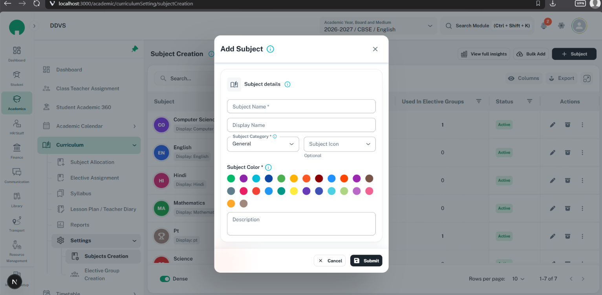

# CustomDialog: small form UI consistency

Use `CustomDialog` for a short, focused create/edit form with a small number of fields that
fit a compact task. Use a [drawer](drawers.md) for long forms, many groups, or substantial
repeating content; use [ConfirmDialog](confirmations.md) for a focused decision. Every form,
including a small dialog, groups its fields using the [section standard](sections.md).
This replaces the previous compact form-dialog guide.

For a read-only record dialog, also follow [the Policy-view standard](detail-pages.md): required
header `titleInfo`, section `descriptionTooltip`/helpText, matching section typography and saved
label/value details, and Close-only footer. A centered shell does not relax the view's info rules.

Use [button-family.md](button-family.md) for shared button APIs, sizes, icons, and busy/disabled
behavior. DialogActions retains its own padding and 12 px action spacing; do not double the gap.

Use [NumericFormatCustom](numeric-format-custom.md) for amount, percentage, and count fields;
keep its shared labels, required/help/validation treatment, and formatNumber display rules.

Use [CustomUpload](custom-upload.md) for attachment types/size, required/helper/error treatment,
upload progress, preview/remove actions, and upload-aware busy/dirty-close handling.

Use [empty and loading states](empty-loading-states.md) for compact search/no-results messages,
initial skeletons, and FormBusyRegion; keep footer and shell close locks wired separately.

## Reference image

The user supplied this Add Subject reference, visually inspected on 16 October 2026. It shows
a light-theme create dialog on `localhost:3000/academic/curriculumSetting/subjectCreation`, over
the Subject Creation table. The image includes browser chrome; CSS viewport/scale are unknown.
The depicted fields are unsubmitted; validation, dirty-close, and loading behavior are not shown.

| Reference | Linked asset | Preserve |
| --- | --- | --- |
| Add Subject | [CustomDialog form](../assets/form-dialog.png) | Centered compact dialog; Title Case title with info and close; one field section with leading icon and help; compact inputs; outlined Cancel and dark Submit with leading icons |



Use the screenshot for composition, not permission or validation rules. Its `Subject details`
section title is superseded by the user's confirmed Title Case: `Subject Details`. Apply the
shared section typography and sentence-case field terminology rather than copying older casing.

## Anatomy and component choice

```text
CustomDialog
  Fixed header: Add Subject [Info]                                [Close X]
  DialogScrollContent (one scrolling body)
    FormSectionCard: [Leading icon] Subject Details [Info]
      Labeled fields, required *, field help where needed, helpers/errors
  DialogActions (outside scrolling body)
                                                  [X Cancel] [Save Submit]
```

- Reuse the shared dialog; do not hand-roll a modal, repeat the title inside the body, or put
  page breadcrumbs, table filters, summary cards, or unrelated actions in the form.
- A small form may have one meaningful section containing its related fields. Do not split
  every isolated input into a separate card or remove sections simply because the form is short.
- Preserve parent table filters, paging, and selection context while the dialog opens/closes.
  The dialog owns focus while open and returns it to the launching control on close.
- Match equivalent create/edit widths. Default `maxWidth="xs"` is the compact reference; choose
  a wider supported size only when the content needs it. Do not squeeze long workflows into it
  or set arbitrary screenshot-derived widths/heights.

## Header, help, and sections

- Use a clear Title Case action/object title: `Add Subject` or `Edit Subject`. Preserve entered
  record names. Use the shell's `titleInfo` for concise title help instead of hand-building a
  second title/info row. Keep the top-right X available and accessibly named.
- Header help explains purpose or one relevant consequence, not a paragraph of generic advice.
  The existing Student Onboarding exception still omits redundant generic title help; material
  instructions and errors stay visible where needed.
- Every standard section uses a neutral semantic leading icon, Title Case heading, and accessible
  info control. Follow [sections.md](sections.md) for `subtitle1`/600 titles, spacing, consistent
  form/view names, and restrained body text. Do not add explanatory subtitles beneath every header.
- Use `GlobalIcons` with `Iconify` for leading/action/help icons. Existing shell internals still
  use MUI info/close icons and the section header has a literal info identifier; treat centralizing
  those as implementation debt, not a reason to copy raw icon strings into screen code.

## Fields, labels, and validation

- Use Formik/Yup and the feature's actual schema. Fields have persistent visible labels, stable
  name/id, `size="small"`, and `fullWidth` where suitable. The same concept uses the same label
  and helper/error terminology across create, edit, and view.
- Required editable fields show exactly one `*` and accessible required meaning, reflecting
  validation. Optional fields are not starred. Do not combine a manually appended star with an
  automatic required indicator. Asterisks belong to fields; buttons have leading action icons.
- Wrap every required field/control in the shared `ShakingTextField`, following the
  [required-field wrapper rule](sections.md#shared-required-field-wrapper). Keep the actual
  shared input inside it and use the same touched/submission error state for wrapper and field;
  the wrapper does not replace required markers, visible errors, or field styling.
- Use full-width rows for name/display name/description. Pair compact related selectors only
  when labels/values remain readable; stack them on narrow screens. Give required errors space
  without overlapping the next control. Keep multiline inputs naturally sized.
- Put field info where choices need explanation, as shown for Subject Category and Subject Color.
  Keep it keyboard reachable and accessibly named. Do not hide validation or mandatory instructions
  inside tooltips. Avoid repeating the same guidance in helper text and tooltip.
- Preserve useful format/range guidance and character counts; avoid filler helper text. Do not
  copy screenshot required flags, defaults, or numeric limits into unrelated forms.
- Custom choices such as color swatches need accessible names, selection indication beyond color,
  and keyboard operation. Do not infer that behavior is verified from the screenshot.
- Validate before sending; show touched/submission errors near the owning field, focus the first
  invalid input, and preserve values after a server error. Keep a useful form-level error when
  a server failure cannot map to one field.

## Spacing, buttons, and responsive layout

Spacing properties use current 8 px theme units. Keep the shell's padding ownership; do not add
another padded dialog wrapper or change button sizes to imitate screenshot pixels.

| Area | Standard / current source |
| --- | --- |
| Dialog | Shared theme radius 16 px, `fullWidth`, compact `maxWidth="xs"`; existing theme margins protect viewport edges |
| Header | Shell `px: 2`, `py: 2.1`; title/help gap `0.5`; fixed above scrolling content |
| Body | `DialogScrollContent` owns `p: 2`; no second outer padding; one scroll owner |
| Sections | Shared card and heading spacing from [sections.md](sections.md); between groups `spacing={2}` |
| Inputs | Use the shared small controls and section grid; the current Subject example uses grid spacing `1.5`, while the standard section grid uses `2` |
| Footer | `DialogActions` owns `p: 2`, border/surface, and right alignment outside the body scroll |
| Footer spacing | Current dialog theme spaces successive actions by `1.5` (12 px); do not also add `gap` and double the spacing |
| Buttons | Theme `size="small"`, height 30 px, content width; preserve theme padding, font, radius, and icon/text spacing |

Cancel is an outlined neutral `type="button"` with leading `GlobalIcons.cancel`. Submit is a
contained neutral `type="submit"` with leading `GlobalIcons.submit`; label it `Submit` for
ordinary create/edit. Both use small size, with Cancel first and Submit last/rightmost. Submit
has the standard black/dark fill and white text in light mode; use inherit/theme colors so dark
mode retains contrast. Do not add primary/success accents, custom heights, or arbitrary widths.
Use `SubmitButton` or the existing loading-capable button where its API fits. `CancelButton`
cannot currently receive `disabled`; use supported MUI Button props or a shared extension when
busy locking is needed. Every footer button has its relevant leading icon.

On narrow screens preserve edge margins, stack fields, wrap long title text, and keep header X
and footer reachable. Scroll only the body when the viewport/mobile keyboard reduces height;
do not shrink text or make the whole page scroll behind the modal.

## Cancel, close, and unsaved changes

Use one dirty-state source and one close/confirmation owner for footer Cancel, header X, Escape,
and supported navigation away. Compare actual form values to the initialized baseline; a focus
or touched flag alone is not a change. Never reset values before asking whether to discard.

| State / action | Required result |
| --- | --- |
| Clean Cancel/X/Escape | Close once and clean up the session; no unnecessary discard prompt |
| Dirty Cancel/X/Escape | Keep dialog/values mounted; open one `Discard Unsaved Changes?` confirmation |
| `Keep Editing` or safe confirmation dismissal | Close only confirmation, retain values, return focus to the form |
| `Discard Changes` | Reset the draft, selected edit identity, and local dirty baseline; close both surfaces; do not save |
| Backdrop click | Current `CustomDialog` ignores it, even while clean; preserve this default. If explicitly enabled later, route it through the same close guard |
| Blocking load/save | Lock affected inputs, Submit, Cancel, X, Escape, and conflicting navigation; prevent duplicate submit and close/discard races |
| Failed submit | Keep values/errors and context; release lock; allow retry or guarded cancellation |
| Successful submit | Reset baseline/session and close according to the workflow; do not show an immediate discard prompt |

Use the existing `ConfirmDialog` with safe `Keep Editing` and explicit `Discard Changes` actions,
following [confirmations.md](confirmations.md). Keep its backdrop from discarding values. Do not
stack a browser confirmation and custom confirmation for the same attempt.

The current `CustomDialog` guard uses `window.confirm`; it does not expose a custom discard popup.
To use the shared popup, let the owning form implement `requestClose`, pass it as `handleClose`,
set `guardUnsavedChanges={false}`, and wire Cancel to that same function. Keep
`disableClose={busy}` and footer/input locks. The local owner must still protect navigation/unload
where applicable; disabling the shell guard also disables its before-unload listener. Keep local
dirty state isolated from a parent form. Do not clear global parent dirty state from a child dialog.

## Current API and submission ownership

| Concern | Actual API / constraint |
| --- | --- |
| Shell | `open`, `handleClose`, `title`, optional `titleInfo`, `maxWidth`, `paperProps`, and MUI dialog props |
| Close protection | `disableClose`, `hasUnsavedChanges`, `guardUnsavedChanges`; no `onDiscard` or `onConfirmClose` prop |
| Body | Named `DialogScrollContent` export; put `DialogActions` outside it |
| Form element | `hasForm` defaults true; the shell renders a form whose current submit handler only prevents default |
| Owned form | For a single feature-owned `<form onSubmit={formik.handleSubmit}>`, use `hasForm={false}` so the shell is non-form; never nest forms |
| Keyboard submission | Wire one actual form-submit path; do not pair the same `submitForm()` click handler with a second native handler that duplicates the mutation |
| Shortcut | `DialogScrollContent.onSubmit` adds Ctrl/Cmd+Enter handling; do not supply it for ordinary forms or advertise a shortcut |
| Confirmation | `ConfirmDialog` takes `open`, `onClose`, `cancelText`, `action`, and dismissal locks; action callbacks belong to the owner |

For a feature-owned form, keep that form a flex column around the scroll body and footer, and
let its native submit event reach Formik once. Default `hasForm={true}` alone is not proof of
Enter-key submission. Extend/reuse a supported shared submission pattern if the feature needs
one; do not invent a Formik-specific shell prop or silently sacrifice keyboard submission.

## Component relationships

| Component / reference | Source / related guide |
| --- | --- |
| `CustomDialog`, `DialogScrollContent` | [Implementation and inline props](../../../../src/components/customDialog/index.tsx), [close guard](../../../../src/components/customDialog/close-guard.ts) |
| Section wrapper/help | [Section guide](sections.md), [FormSectionCard](../../../../src/components/form-section-card/index.tsx), [FormSectionHeader](../../../../src/components/form-section-card/section-header.tsx) |
| Required-field feedback | [ShakingTextField](../../../../src/components/shaking-text-field/index.tsx), [wrapper rules](sections.md#shared-required-field-wrapper) |
| Footer buttons | [SubmitButton](../../../../src/components/submit-button/index.tsx), [CancelButton](../../../../src/components/cancel-button/index.tsx), [button theme](../../../../src/theme/core/components/button.tsx), [dialog theme](../../../../src/theme/core/components/dialog.tsx) |
| Confirmation | [ConfirmDialog](../../../../src/components/confirm-dialog/confirm-dialog.tsx), [types](../../../../src/components/confirm-dialog/types.ts), [confirmation guide](confirmations.md) |
| Dirty-state reference | [BackPopUpChecked](../../../../src/components/back-popup-check/BackPopUpCheck.ts); existing global bridge, not a second source to add beside local dirty state |
| Icons / tooltips | [GlobalIcons](../../../../src/utils/icons.ts), [Iconify](../../../../src/components/iconify/iconify.tsx), [CustomTooltip](../../../../src/components/custom-tooltip/index.tsx) |
| Supplied screen | [Subject form](../../../../src/screens/academic/curriculum-management/setting/subjectCreation/subjectForm.tsx), [owning screen](../../../../src/screens/academic/curriculum-management/setting/subjectCreation/index.tsx), [close hook](../../../../src/screens/academic/curriculum-management/setting/subjectCreation/hooks/useSubjectCreation.ts) |

## Verification and inconsistencies

Verify compact-dialog versus drawer choice; Title Case title/section; header and section help;
required markers; useful field help/errors; shared spacing; outlined Cancel/dark Submit with
leading icons and small size; body-only scroll; one submit path; dirty versus clean Cancel/X/Escape;
Keep Editing/Discard; busy locks; save failure/success; focus return; both themes and narrow widths.
For documentation changes check links/assets, skill structure, and whitespace. UI changes also
need focused checks and the required in-app browser smoke test.

Confirmed source differences: the Subject section uses `Subject details` and default `subtitle2`
instead of the shared Title Case/`subtitle1` section standard; edit uses `Update` with an Edit icon
rather than ordinary `Submit` with the submit icon. Subject and shell paths currently use native
browser confirmations rather than the shared discard popup. The shell's default native submit
handler only prevents default, and some title/section/field icons do not use `GlobalIcons`.
Those are implementation gaps to resolve when changing the UI; documentation does not fix them.
Runtime dirty-close behavior, keyboard submission, loading locks, focus, color-choice accessibility,
both-theme styling, and viewport matching remain Unverified until tested in the running application.
