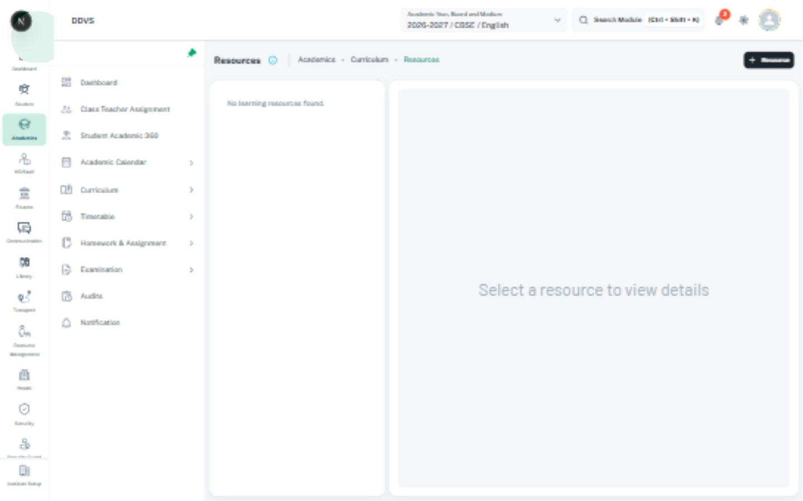

# Hierarchy trees and nested resource navigation

Use a hierarchy when parent/child relationships are the task, not as an alternative table style.
Read [navigation](navigation-settings.md), [status labels](status-labels.md), and the owning
permission/domain rules before adopting selection or action behavior.

## Existing references

- [Learning Resources HierarchyTree](../../../../src/screens/academic/course-management/learningResources/components/treeStrcutre.tsx)
  groups actual resources by class, subject, and chapter, using MUI X SimpleTreeView/TreeItem.
  Its inputs are `resources`, optional `isLoading`, `onEdit`, `onArchive`, and `onPublish`.
- [Tree styling example](../../../../src/components/tree-view/custom-styling.tsx) is an existing
  styling reference, not proof of a production shared data/permission tree API.
- [Security documentation](../../../../docs/security/README.md) owns permission/visibility
  workflows. Do not replace its approved grouped controls with a generic tree editor.

## Rules

- Give the tree an accessible name and keep unique, stable item IDs across nesting/filtering.
  Duplicate visible names must not collide. Preserve meaningful parent/child ordering.
- Separate expansion, selection, opening a record, and contextual actions. Expanding a branch
  never edits a record, selects every child, grants a permission, or triggers archive/publish.
- Follow MUI X keyboard behavior: arrow navigation/expansion, reachable selected items, visible
  focus, and announced expanded/selected states. Do not replace item semantics with clickable divs.
- Keep node label, optional status, count, and permitted actions consistently aligned. Counts
  distinguish loaded children from server totals when that difference exists.
- Keep long labels readable through wrapping or an accessible full-name treatment. Bound tree
  scrolling within its workspace; do not force every nested level into wider document overflow.
- Stop action propagation so an edit/menu click does not also select or expand the node. Follow
  the normal confirmation and busy locks for consequential actions.
- Preserve selected/expanded identity across refresh where still valid. Explain loading, empty
  branch, filtered no-results, failure/retry, and unavailable nodes without implying data deletion.
- The current resource tree exposes `isLoading`, but inspect its implementation before claiming
  a loading region, lazy child loading, checkboxes, or controlled selection API exists.

## Image and checks

Use [the local Learning Resources capture](../assets/local-resource-hierarchy.jpg) only for the
state recorded in [capture metadata](image-references.md#local-app-captures-22-october-2026).
An empty hierarchy is not visual evidence for expanded/populated nodes. Check stable IDs,
keyboard paths, independent actions, refresh/filter retention, leaf/branch states, and narrow layout.
