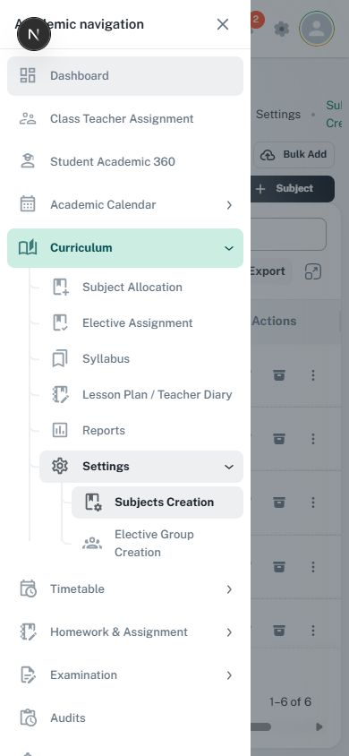

# Application navigation and settings destinations

Use [DESIGN.md navigation](../../../../DESIGN.md#route-creation-and-navigation-configuration) and
[settings decisions](../../../../DESIGN.md#settings-navigation-and-decisions). This guide adds
component routing; it does not change route permissions or introduce a new navigation system.

## Source map

| Concern | Existing owner |
| --- | --- |
| Authenticated layout | [DashboardLayout](../../../../src/layouts/dashboard/layout.tsx), [desktop nav](../../../../src/layouts/dashboard/nav-vertical.tsx), [mobile nav](../../../../src/layouts/dashboard/nav-mobile.tsx) |
| Module-local sidebar and phone drawer | [SubLayout](../../../../src/components/sub-layout/index.tsx); owns the captured Open/Close Academic navigation controls |
| Navigation item/group rendering | [NavSection types](../../../../src/components/nav-section/types.ts), [vertical section](../../../../src/components/nav-section/vertical/nav-section-vertical.tsx) |
| Module routes, labels, icons, permission gates | [Navigation config](../../../../src/layouts/config-nav-dashboard.tsx), owning `src/constants/*-menu.ts`, [paths](../../../../src/routes/paths.ts) |
| Page identity and back behavior | [Page headers](page-headers.md), [tabs](custom-tabs.md) |
| Durable settings tasks | [Student records settings](../../../../src/screens/student/records/records-settings.tsx), [identity navigation](../../../../src/screens/setting/school-identity/identity-navigation.ts); inspect the owning feature before reuse |

## Rules

- Reuse the shell. Keep primary modules and module-local destinations distinct, with stable labels,
  ordering, icons, active-route treatment, and collapsed/expanded presentation across equivalent pages.
- Derive active state from the actual route using existing path helpers. Parent groups can expand
  without navigating or altering data. Prefix collisions must not select unrelated destinations.
- Configure routes/menu entries in their owning constants, then wire App Router and screen entry.
  Preserve permission filtering and disabled/prerequisite explanations; hidden navigation is not security.
- On mobile, use the existing drawer with a named opener, focus handling, Escape/backdrop policy,
  and safe dismissal on route selection. Do not duplicate a permanent desktop sidebar at phone width.
- Meaningful settings tasks are URL-backed destinations with concise outcome descriptions.
  Preserve reload/back/forward/deep links and invalid-route fallback. Do not put a second local
  tab system below a broad task when its children are peer destinations.
- Use stepper navigation only for a genuinely ordered workflow. Use decision cards when settings
  alter business behavior: name the choices, explain consequences and actual recommendations,
  and retain native keyboard/selection semantics.
- Breadcrumbs identify location. Put lifecycle actions beside their record/year state where the
  settings contract requires it; ordinary page create actions still follow [page headers](page-headers.md).
- Route/context changes pass through the existing unsaved-work owner. Preserve drafts and actual
  busy locks; do not attach a second global confirmation to every navigation item.

## Images and checks

Use [the desktop subject workspace](../assets/local-subject-workspace.jpg) and
[the phone navigation capture](../assets/local-navigation-mobile.jpg). These establish shell and
active group placement only; they do not approve a new menu, route, or permission mapping.
See [capture metadata](image-references.md#local-app-captures-22-october-2026).
Check deep links, nested active states, keyboard navigation, group expansion, route guards,
mobile focus/dismissal, long labels, and dirty/blocked navigation.
