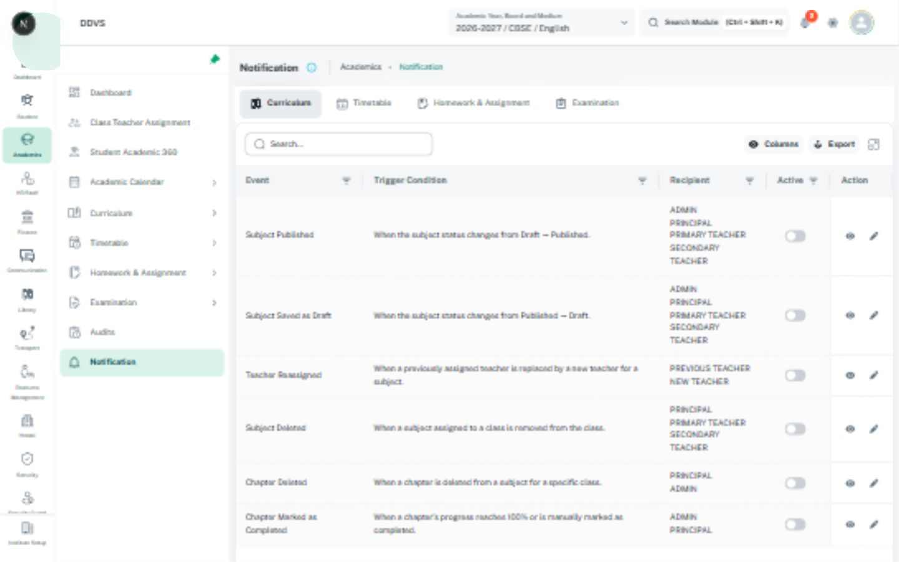

# Notification composition and notification lists

Use the existing communication flow with [form dialogs](form-dialogs.md), [editor](rich-text-editor.md),
[feedback](feedback.md), and [academic scope](academic-scope.md) where relevant. A notification
composer is a form, not a confirmation modal merely because it has a Send button.

## Existing references

| Concern | Source / contract |
| --- | --- |
| Shared instant composer | [SendInstantNotificationDialog](../../../../src/components/send-instant-notification-dialog/index.tsx), [props](../../../../src/components/send-instant-notification-dialog/send-instant-notification-interface.tsx) |
| Larger communication composition | [NotificationFormStepper](../../../../src/screens/communication/settings/Notification/SendNotification/NotificationFormStepper.tsx) |
| Shell notification list | [Notifications drawer](../../../../src/layouts/components/notifications-drawer/index.tsx), [item](../../../../src/layouts/components/notifications-drawer/notification-item.tsx) |
| Academic notification workspace | [AcademicNotification](../../../../src/screens/academic/AcademicNotification/index.tsx) |

## Rules and API limits

- Make recipients/audience, channels, subject, and message visible where the workflow supports
  them. Recipient chips/counts must refer to the actual selected scope, not all users by assumption.
- Show available channels truthfully. SMS/WhatsApp entries marked coming soon in the current
  composer do not establish usable delivery support. Keep unavailable choices inert and explained.
- Preserve the existing placeholder/token contract and available recipient fields. Preview must
  distinguish literal placeholders, sample substitution, and actual recipient-specific content.
  Do not place real personal messages or recipient contact details in reference assets.
- Validate required audience/channel/content before sending through the existing schema/API.
  The current shared composer has no proof of complete validation merely because it uses Formik.
- Inspect the shared props: `open`, `onClose`, `data`, `userList`, optional `onSend`, `isSending`.
  Its `data`/`userList` inputs alone do not prove a recipient selector is rendered; it currently
  edits channels, subject, and message. Do not invent `recipients` or `onPreview` props.
- Await a real send callback and keep values after failure. Lock Send, inputs, Cancel/close,
  Escape, backdrop, and conflicting navigation during a blocking send; a loading Send button
  alone is insufficient. Reuse the owning dirty-close boundary.
- Distinguish submitted/queued, delivered, failed, and read/acknowledged states according to the
  actual backend contract. Do not label a queued request as delivered or an opened drawer as read.
- Lists retain read/unread meaning, useful time formatting, accessible item actions, empty/error
  states, and permitted deep links. Apply bulk actions only to their actual eligible scope.

## Image and checks

Use [the local notification workspace](../assets/local-notifications.jpg) for its inspected tab
and table composition. It is not evidence that sending or delivery succeeded. See
[capture metadata](image-references.md#local-app-captures-22-october-2026). Composer/channel/recipient
states absent from that capture remain unverified. Check validation, tokens, unavailable channels,
send failure/retry and duplicate prevention, dirty close, unread semantics, and phone layout.
