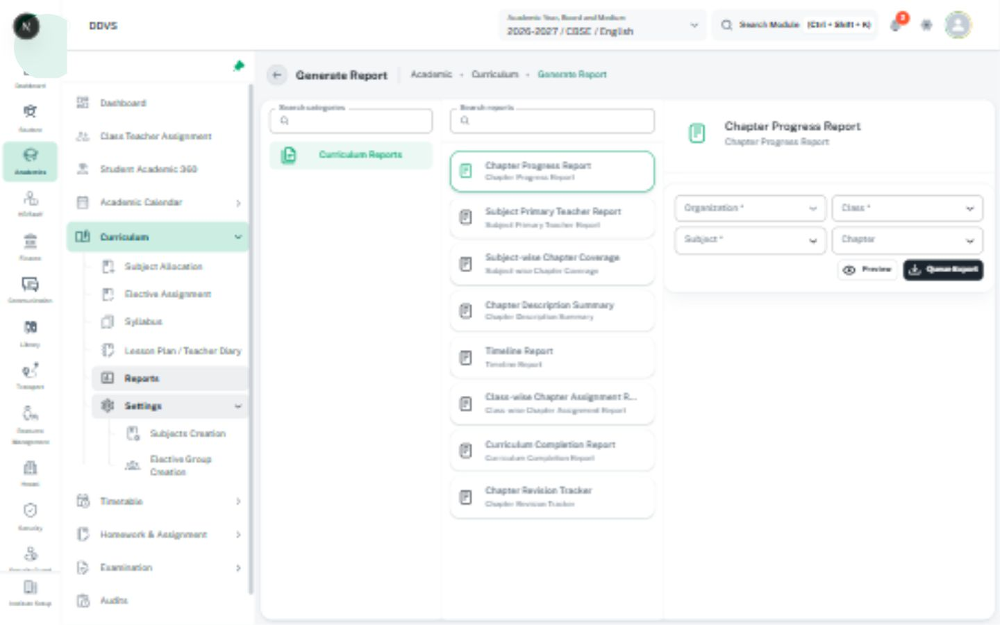

# Calendars, scheduling, reports, audit, and document preview

These surfaces already have written rulebooks. Read the matching guide below; reuse its
behavior rather than copying a CRUD layout or creating a second set of domain rules here.

| Surface | Owning rules | Existing implementation references |
| --- | --- | --- |
| Calendar grid, view controls, events, working days | [Calendars](../../shikshamitra-fe-patterns/references/calendars.md) | [Shared calendar](../../../../src/components/calender/index.tsx), [AcademicCalendarView](../../../../src/screens/academic/academic-calendar-management/calendarManagement/components/AcademicCalendarView.tsx) |
| Timetable, room/seat planning, capacity and conflicts | [Scheduling](../../shikshamitra-fe-patterns/references/scheduling-workspaces.md) | [Timetable preview](../../../../src/screens/academic/timetable-schedule-management/timeTable/component/TimetablePreviewDialog.tsx), [seating publication warnings](../../../../src/screens/examination/seatingPlan/guided/steps/publication-warnings.tsx) |
| Report choice, filters, preview, queued export, expiry/download | [Reports and exports](../../shikshamitra-fe-patterns/references/reports-and-exports.md) | [CommonReport](../../../../src/components/common-report/index.tsx), [types](../../../../src/components/common-report/types.ts), [CurriculumReports](../../../../src/screens/academic/curriculum-management/reports/CurriculumReports.tsx) |
| Audit tables, filters, diff/timeline/analytics | [Audit logs](../../shikshamitra-fe-patterns/references/audit-logs.md) | [Academic audit workspace](../../../../src/screens/academic/academic-calendar-management/auditLogs/index.tsx), [details drawer](../../../../src/screens/academic/academic-calendar-management/auditLogs/components/AuditLogDetailsDrawer.tsx) |
| File preview, download, upload, and attachments | [CustomUpload](custom-upload.md#preview-download-remove-and-view-details) | [DocumentPreviewDialog](../../../../src/components/preview-document/DocumentPreviewDialog.tsx), [protected preview](../../../../src/components/preview-document/fetch-protected-preview.ts), [PDF viewer](../../../../src/components/preview-document/pdf-preview/index.tsx) |

## Shared visual and interaction boundaries

- Keep each owning workspace's scope, controls, legend, content region, and actions in a stable
  order. Preserve the module header, region-owned loading/error, and bounded scroll behavior.
- Calendar category colors, scheduling conflicts, audit changes, and report job states use their
  own truthful labels plus semantic signals; do not reuse one color map for unrelated meanings.
- Calendar drag/resize and scheduling placement are mutations only when the actual workflow
  supports them. Preserve restrictions, keyboard alternatives, validation, pending changes,
  cancel/undo policy, and real save/publish boundaries; do not infer behavior from a static image.
- Exporting visible rows and generating a scoped report are distinct operations. Make filters,
  report format, progress, expiry, and available retry/download actions clear. Preview is not export
  completion; queued is not ready. Do not generate reports merely to obtain a reference image.
- Audit views preserve actor/time/reason/old-versus-new meaning and authorized scope. Avoid
  copying sensitive audit values into assets. Present missing/redacted values truthfully.
- File preview keeps its parent draft mounted, uses the existing authorized fetch path, distinguishes
  unsupported type from network/permission failure, releases object URLs, and returns focus on close.
  Do not replace protected files with public links or a guessed URL prefix.

## Images and verification

Use [the calendar capture](../assets/local-calendar-workspace.jpg) for calendar composition and
[the empty upload capture](../assets/local-upload-empty.jpg) for attachment placement. None proves
report generation, event saving, populated audit history, scheduling drag behavior, or file-preview
success. Metadata and missing-state coverage remain explicit in [image references](image-references.md).
Verify the owning rulebook's real workflow and responsive/keyboard/busy/error cases when implementing.
