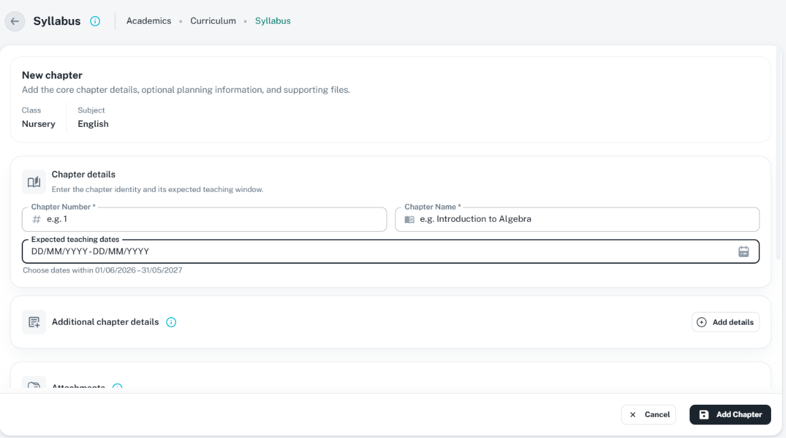

# Page forms and matching view details

Use a page form for a larger independent task that needs more space than a compact
[CustomDialog](form-dialogs.md) or contextual [drawer](drawers.md). The shell changes; the
[section standard](sections.md), labels, field shape, icons, helpers, required markers,
ShakingTextField feedback, and corresponding saved-detail structure stay the same.
For an ordered multi-stage page form, use [the shared stepper form guide](stepper-forms.md),
including its validation boundaries, progress/navigation, preview, and draft/final actions.

Use [button-family.md](button-family.md) for common footer buttons, 30 px small sizing, leading
icons, 8 px action-group spacing, and loading/disabled behavior. Keep the owning page footer layout.

Use [NumericFormatCustom](numeric-format-custom.md) for amounts, percentages, and counts,
with shared labels, required markers, info/help, validation, and formatNumber for saved numbers.

Use [CustomUpload](custom-upload.md) for attachment types/size, required/helper/error treatment,
progress and preview/remove actions; retain the same attachment section in saved details.

Use [empty and loading states](empty-loading-states.md) for scoped messages, section skeletons,
safe refresh, and FormBusyRegion save locks without unmounting entered values or the page shell.

## Reference and composition

The user supplied this Syllabus chapter-form reference, inspected on 16 October 2026. It shows
light theme, page header/back action, chapter context, Chapter details, Additional chapter
details, part of Attachments, and a stable footer. Only visible content is established; the
image does not verify the complete schema or submission behavior.



```text
CustomBreadcrumbs: Back | Page Title [Info] | breadcrumbs
Necessary task context only, such as class/subject
Scrollable page content:
  [Leading icon] Section Title [Info]
    Related inputs or corresponding saved label/value details
  Other meaningful sections in the task's existing order
Stable form footer:                                         Cancel | Submit
```

- Keep `CustomBreadcrumbs` first and preserve owning module navigation. Do not add repeated
  title/description cards merely to imitate the reference. Keep context only when it identifies
  the task or explains scope.
- Every logical field group uses the same section header/card presentation as drawers/dialogs:
  Title Case, leading `GlobalIcons` icon, accessible info, `subtitle1`/600 title, neutral body,
  and shared padding/grid spacing. Wide pages may have more columns only when content remains
  readable. Do not use a different section design for the same record's view.
- Preserve meaningful field labels/order and all applicable saved details. Replace inputs with
  read-only label/value presentation in view mode; preserve units, option labels, boolean/zero,
  dates, and useful server-owned metadata in their proper sections. No disabled-input faux view.
- Use [CustomSelect](custom-select.md), [searchable dropdowns](searchable-dropdowns.md),
  [single-date pickers](date-pickers.md), and [range pickers](date-range-picker.md) as appropriate.
  Every required input uses one star and the shared shake wrapper without changing its field shape.
- Section spacing remains `2`; fields/helpers align and stack on narrow widths. The content has
  one clear scroll owner. Footer must not cover the last field/error; add only its actual layout
  allowance, not arbitrary screen-height spacers or a table-workspace height rule.
- Keep Cancel before the neutral dark contained Submit, small size with relevant GlobalIcons
  leading icons. Follow the existing common form rule for ordinary submissions; the image's
  `Add Chapter` is a legacy label, not a new universal button convention.
- Back, Cancel, navigation, and other supported leave paths share the existing dirty-state owner
  and [Keep Editing / Discard Changes confirmation](confirmations.md). A picker Cancel closes
  only its own popup; it does not discard the page. Lock conflicting navigation during saving,
  prevent duplicate submission, preserve errors/values after failure, and reset baseline on success.

## Sources, differences, and verification

See [ChapterDetailsSection](../../../../src/screens/academic/course-management/syllabusManagement/components/ChapterDetailsSection.tsx),
[ChapterContextHeader](../../../../src/screens/academic/course-management/syllabusManagement/components/ChapterContextHeader.tsx),
[FormSectionCard](../../../../src/components/form-section-card/index.tsx), and
[shared detail primitives](../../../../src/components/detail-view/index.tsx).

The reference's `Chapter details` / `New chapter` casing and visible section subtitle differ
from the confirmed Title Case/section-info standard; implement `Chapter Details` / `New Chapter`
and put optional section guidance in info help. Preserve real input helpers and task context.
Check all sections and field types across page/dialog/drawer and view, required shake feedback,
date/dropdown validation, footer visibility, safe cancellation, keyboard, long content, and
narrow layouts. Source/image review does not claim runtime fixes or passing browser checks.
