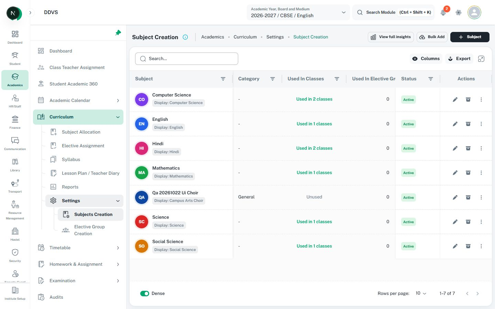

# Page headers and breadcrumbs

Adapted from [page-header rules](../../shikshamitra-fe-patterns/references/page-headers.md)
and [DESIGN.md](../../../../DESIGN.md), including module-family header consistency.

## When to use

Use for page titles, breadcrumb context, page actions, domain filters, and status navigation.
For peer-panel tab workspaces, read [CustomTabs](custom-tabs.md), including the Learning Tasks
reference, selected styling, tab/action-row spacing, and URL/unsaved-navigation behavior.

## Reference image

Captured from the local Academic module; see [metadata](image-references.md#local-app-captures-22-october-2026).
Use its title/help, breadcrumb, context, and page-action placement for this module family.
The image is unannotated and does not establish a new header layout for every module or approve
all legacy action labels, icon counts, and status styles in the rest of the screen.

## How to build

1. Use `CustomBreadcrumbs` as the first visible content in the authenticated screen body, before
   filters, alerts, cards, tabs, tables, loading states, and charts.
2. Supply the heading, meaningful description, real route links, and the relevant action/back
   behavior. The current breadcrumb item normally has no href. Use route constants.
3. Inspect comparable pages in the same module. Preserve their inline/stacked layout, root label,
   route hierarchy, description treatment, and action placement. HR uses inline layout without
   an `HR/Staff` prefix. Include real navigable ancestors and current-page text; omit sidebar
   groups without a landing screen. Payroll descendants link `Payroll Management` to
   `hrPaths.payroll.root`.
4. Follow with only useful page context: selectors, domain filters, status navigation, or metrics.
   Do not add every possible header element or repeat the title inside a content card.
5. Contained filter/action and status-tab rows use `px: 1` without a second nested inset. Keep
   vertical padding tied to the shared controls. Keep primary page actions aligned to the right.

## Actions and navigation

- Keep equivalent create/add actions in the same header position and gate them by permission.
  Use the established icon and label; add actions may use a plus icon.
- Matching settings pages may use a plus icon with an object-only label, provided the accessible
  name includes the action, such as `Add Rubric Template`.
- Place record/year lifecycle actions beside the status they affect when the settings workflow
  requires it; do not move them into breadcrumbs just because create actions use that location.
- Use informational breadcrumbs, not unrelated page controls disguised as breadcrumb items.
- Use meaningful URL-backed state for persistent workspace tabs and shareable filters. Exclusive
  domain filters may look like tabs but retain button/radio semantics.
- Keep the header mounted during content loading, refreshing, and errors.
- Tabbed workspaces may place contextual insights/create actions once at the right of the
  contained CustomTabs row, as in Learning Tasks. Tabs stay left, filters follow below, and
  actions match the active panel. Do not repeat those actions in the breadcrumb header.

## Responsive and verification rules

- Allow header controls to wrap safely while preserving their order and action alignment.
- Keep descriptions concise; expose help through the existing accessible treatment.
- Verify the first visible content, actual route destinations, current-page non-link item, module
  layout, action permissions, `px: 1` rows, keyboard access, and no horizontal document overflow.

## Code reference

Inspect `src/components/custom-breadcrumbs/types.ts` and the current component before wiring props.
For HR, inspect `src/screens/hr/employee/employee.tsx` and
`src/screens/hr/employee-onboarding/index.tsx`; other modules use their own current header family.
