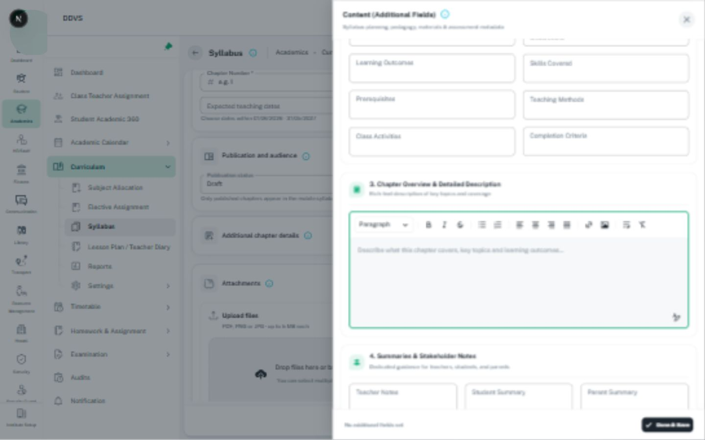

# Rich-text editor and formatted content

Use [Editor](../../../../src/components/editor/editor.tsx), [its types](../../../../src/components/editor/types.ts),
and [the toolbar](../../../../src/components/editor/toolbar.tsx). Follow
[DESIGN.md Editor](../../../../DESIGN.md#18-editor); do not create a feature-local editor framework.

## Contract and composition

- `value` is HTML; `onChange(value)` returns HTML and normalizes empty text to an empty string.
  Keep the owning form as the source of truth. Validate actual content, not HTML string length:
  an empty paragraph or whitespace is not meaningful required input.
- `error` and `helperText` carry field feedback. Supply a visible associated field label and
  accessible editor name through supported editor options/composition; placeholder alone is not a label.
- `editable`, inherited from editor options, controls editing; it is not a generic `disabled` prop.
  Inspect the current toolbar behavior as well as the editor surface before claiming a busy/read-only lock.
- `isToolbarShow`, `fullItem`, `resetValue`, `placeholder`, and `slotProps.wrap` are supported.
  Do not invent `maxLength`, upload handlers, or form event props without verifying forwarding.
- Use only formatting the feature supports. Keep toolbar grouping, active/disabled states, labels,
  and theme sizing consistent; do not expose authoring controls in a saved-detail presentation.
- `mentionable` and `mentionItems` enable the existing placeholder flow. Selection inserts
  bracketed label text, not a guaranteed persistent mention entity. Preserve the feature's token contract.
- Enter edits content; it must not accidentally submit the outer form. Fullscreen and link/image
  controls preserve the draft, accessible naming, focus containment, Escape behavior, and focus return.
- Preview/display preserves meaningful paragraphs, lists, headings, links, and images within its
  container. Use the existing safe rendering pipeline; never treat editor output as trusted HTML
  or invent a sanitizer/backend policy from this visual guide.
- Keep actual links and media contracts. Do not silently upload files, invent attachments, or allow
  the screenshot to redefine accepted formats or authorization.

## Reference and checks

Inspect [Add Chapter](../../../../src/screens/academic/course-management/syllabusManagement/addChapterForm.tsx)
and its additional-details composition. The image establishes the editor region and toolbar,
not the legacy drawer title, numbered headings, or Done & Save wording as shared defaults.
See [capture metadata](image-references.md#local-app-captures-22-october-2026).
Check empty/required content, paste, formatting, external value reset, read-only mode, long words,
keyboard toolbar access, mobile overflow, busy locks, and preservation after errors.
