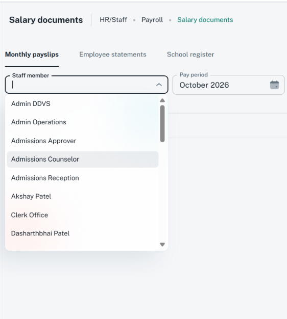

# Searchable dropdowns: ShikshaMitra UI consistency

Follow [CustomSelect field rules](custom-select.md) and [sections.md](sections.md) in every
dialog, drawer, page form, and corresponding view. Search changes how options are found;
it does not change required markers, info/help, field shape, section layout, or validation.

## Choose the existing component

| Data | Component | Contract |
| --- | --- | --- |
| Bounded options already loaded | `CustomSelect` with `isSearch` | Local text filtering of supplied options; selected choices remain in the list |
| Growing remote results | `PaginatedSearchSelect` | Async query/page fetch, debounce, incremental loading, error/retry |
| Intentional creation of new free-text choices | Existing `CreateTableDropdown` only where its contract fits | Creatable/freeSolo behavior is not equivalent to choosing a permitted existing record |

Use the component matching the owning feature; do not add a second search implementation or
fetch a whole large dataset just to filter it locally. Searching for a record never grants
permission to create it.

## Open searchable-dropdown reference

The user supplied this Salary documents / HR/Staff / Payroll image, inspected on 16 October 2026.
It is a 562 x 626 light-theme image with Monthly payslips active, the Staff member field focused
with an empty query, and its option list open. CSS viewport/scale and route are unknown.



Preserve the persistent floating label, outlined small field, input caret, open-state arrow,
left-aligned readable options, restrained rounded popup, subtle highlighted row, and internal
list scrolling. Anchor the popup to its field, contain it in the available viewport, and retain
the library's focus/selection styling. A highlighted option is not proof of a committed choice.
Do not hardcode these staff names, list height, colors, or screenshot pixel dimensions.

The [related Salary documents source](../../../../src/screens/hr/payroll/salarySlip-generate/salary-documents-workspace.tsx)
uses PaginatedSearchSelect for staff lookup; preserve the owning screen's current scope and API.
This screenshot does not establish local-versus-remote fetching behavior, successful filtering,
paging, empty/error/loading states, keyboard behavior, dark theme, or form validation. Verify
those separately. The [drawer reference](../assets/drawer.png) remains useful for closed-field
form composition. Do not use calendar images as dropdown evidence.

## Labels, help, requiredness, and states

- Use a persistent sentence-case label such as `Subject`, a useful search hint, `size="small"`,
  and full width. The placeholder supplements the label. Keep one star via required support.
- Wrap each required picker in [ShakingTextField](sections.md#shared-required-field-wrapper).
  Use the same touch/submission validation error for the wrapper and control, retaining helper
  associations. A network failure is distinct from the user's missing/invalid selection.
- Store the selected stable record identity. Search text is not the selected value; typing or
  highlighting a result must not pass required validation without a valid choice.
- Provide meaningful option labels plus concise disambiguating detail where names repeat.
  Use stable keys/equality by ID, not array index or object reference alone. Preserve the saved
  selection's label when it is absent from the current search page.
- Distinguish initial/continuing load, minimum-character guidance, no matching results, genuine
  empty scope, and failed request with retry. Do not replace a failure with `No options`.
- Preserve input and selection after failures; changing scope/query invalidates stale results.
  Parent context changes must clear/revalidate obsolete selection and reload in the new scope.
- Keep list scrolling inside its popup, unclipped by the dialog/drawer/footer. Preserve combobox
  roles, arrow-key navigation, Enter selection, Escape-to-close, and focus return. A nested
  popup's Escape must not accidentally discard its parent form.
- Field help uses accessible `GlobalIcons.info` composition where supported; required errors
  stay visible. Do not invent an `infoText` prop or replace library input adornments wholesale.

## PaginatedSearchSelect API

Inspect [component](../../../../src/components/paginated-search-select/paginated-search-select.tsx),
[types](../../../../src/components/paginated-search-select/types.ts), and
[search hook](../../../../src/components/paginated-search-select/use-paginated-search.ts).

| Concern | Current behavior |
| --- | --- |
| Required fetch | `fetchOptions(query, page)` resolves `{ data: T[], hasMore: boolean }`; pages are one-based; adapt the real API response |
| Defaults | `minChars=2`, `debounceMs=400`; the hook also loads page 1 for an empty query on mount/clear |
| Value / change | Inherited Autocomplete value and `onChange(event, value)`; typically selected object/null; differs from CustomSelect's value-only callback |
| Identity / display | `getOptionLabel`, `getOptionKey`, `isOptionEqualToValue`, optional `renderOption`; preserve library roles/handlers when customizing |
| Field | `label`, `name`, `required`, `placeholder`, `helperText`, `error`, inherited `size` / `fullWidth` |
| Loading / retry | `isLoading`, `loadingLabel`, internal spinner/error and Retry results; no public `onSearch` or generic `onRetry` prop |
| Matching | For server-ranked results, use supported `filterOptions={(options) => options}` when further client filtering would incorrectly remove matches |

The hook guards stale query responses and appends further pages. It does not infer tenant/parent
scope changes from a stable callback; the owner must deliberately reload/remount the picker for
a new scope and preserve a valid current selection. Do not add a competing local search-state
store. Initial empty-query fetching must also obey the feature's scope/permission contract.

```tsx
// Integration excerpt: Option and callbacks come from the typed feature.
<ShakingTextField error={showSelectionError}>
  <PaginatedSearchSelect<Option>
    label="Subject" name="subject" required size="small" fullWidth
    value={formik.values.subject}
    fetchOptions={fetchSubjectOptions}
    getOptionLabel={(option) => option.name}
    getOptionKey={(option) => option.id}
    isOptionEqualToValue={(option, value) => option.id === value.id}
    onChange={(_event, value) => formik.setFieldValue('subject', value)}
    onBlur={() => formik.setFieldTouched('subject', true)}
    error={showSelectionError} helperText={selectionHelper}
  />
</ShakingTextField>
```

## Existing alternate wrapper and verification

[CreateTableDropdown](../../../../src/components/customAutoComplete/index.tsx) currently uses
freeSolo, name-shaped options, a fixed demo ID, and placeholder as its rendered label. Its broad
props are not proof that required/name/help semantics reach the actual input. Inspect/extend the
shared wrapper before adopting it; avoid it as the default for fixed-ID selections.

Check local search, debounce/racing queries, clear/reselect, duplicate labels, selected value not
in current page, minimum characters, more-page failure/retry, stale scope, required star and
shake gating, keyboard, menu containment, and narrow layouts. No runtime changes or passing
interaction tests are claimed by this guide.
