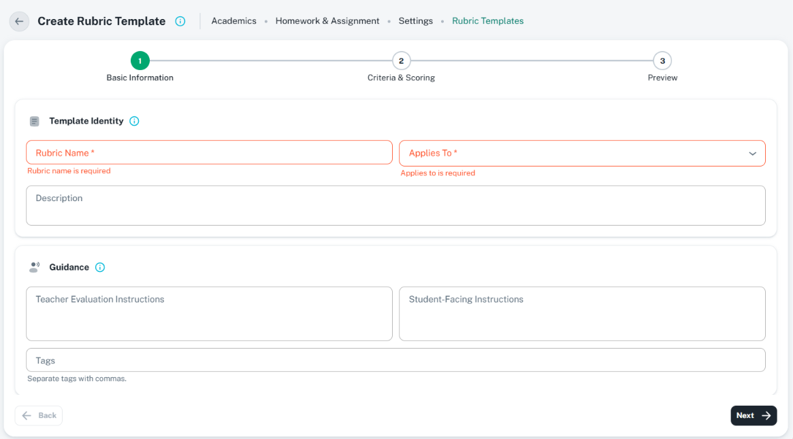

# Stepper forms: ShikshaMitra UI consistency

Use `CustomStepperWithFormik` for a genuinely ordered form with meaningful validation stages.
Use [CustomTabs](custom-tabs.md) for independent peer views. This is the component/form reference
for page and drawer steppers; retain the same [sections](sections.md), fields, validation,
navigation, and action semantics when the outer shell changes.

## Rubric Template reference

The user supplied this Create Rubric Template image, inspected on 16 October 2026. It shows
Academics / Homework & Assignment / Settings / Rubric Templates, light theme, a page form with
Basic Information active, and visible required errors. Route, CSS viewport, and scale are unknown.
The screenshot shows one step, not proof of later-step saving, completion, or drawer behavior.

| Reference | Linked asset | Preserve |
| --- | --- | --- |
| Rubric Template stepper form | [Reference image](../assets/stepper-form-rubric-template.png) | Back/title/info/breadcrumbs; three connected stages; Template Identity and Guidance sections; field-level validation; stable Back/Next footer |



Use these stages for the rubric workflow: `Basic Information`, `Criteria & Scoring`, `Preview`.
Other forms use their real task stages; do not copy rubric fields or invent unnecessary steps.
The screenshot does not supersede shared section typography, field casing, GlobalIcons, or
required `ShakingTextField` rules. Confirmed implementation differences are listed below.

## Page and drawer composition

| Region | Page form | Drawer form |
| --- | --- | --- |
| Header | `CustomBreadcrumbs` first: guarded Back, Title Case task title, concise help, module-family route hierarchy | Preserve the underlying page breadcrumbs; use a drawer title/status/info/X header, not another breadcrumb row inside the panel |
| Steps | Shared horizontal stepper below header, above active content | Same shared component below drawer header; choose a supported layout that fits the panel |
| Content | Active-step sections only; one scrolling form body | Same section names/order, field components, validation, and spacing; fields stack as panel narrows |
| Footer | Shared stable Back at left, Next/save/final actions at right | Same footer and action meanings; do not add a competing drawer Submit footer |
| Leaving | Header Back, breadcrumb links, Cancel, and supported navigation share one dirty-close owner | Header X, Cancel, Escape, backdrop, and supported navigation share that owner and the drawer's dismissal policy |

Keep the stepper close to its content, with continuous centered connectors and evenly distributed
indicators. Do not repeat the page title inside the main card, create one card per isolated field,
or add summaries/checklists/sidebars just to fill space. A supplemental read-only context panel
is appropriate only when the task needs it and it does not compress the active form.

Use one height/scroll chain: bounded page or drawer flex column, `minHeight: 0` on form-containing
flex children, and a flexible active body. The shared component already provides the form,
scrollbar, and footer; do not nest another ordinary-field scroll area or native form around it.
Avoid viewport subtraction and arbitrary screenshot-derived heights. Keep the header/footer
reachable without body content scrolling behind or under them.

## Breadcrumbs and titles

- Page heading describes the task, such as `Create Rubric Template` / `Update Rubric Template`.
  Use the existing module-family header, a meaningful description/info treatment, and real route
  constants. Preserve entered record names inside dynamic titles.
- Keep Academics, Homework & Assignment, Settings, and Rubric Templates in their existing
  hierarchy. Use actual parent destinations when available; current location is normally a
  non-link. Do not invent a separate create route merely because this reference is an inline form.
- Header/breadcrumb Back leaves the workflow through the unsaved guard. Footer Back moves one
  step backward while preserving values. Do not wire these two different outcomes to one reset.
- Drawer header follows [drawers.md](drawers.md): title, meaningful badges, info, X. Drawer task,
  step names, and section titles use Title Case; field labels use consistent sentence case.

## Shared form state and sections

- Use `CustomStepperWithFormik` from `src/components/custom-stepper`. Use its supplied `formik`
  in every rendered step; do not create a separate form for each step or duplicate values/errors.
- Default integration lets the component own Formik. If the workflow needs a parent-owned typed
  form, use its existing `formikInstance` API and keep that instance authoritative throughout.
  The component still creates an internal fallback; do not use it as a second active state owner.
- Supply one complete initial-values contract. Preserve text, selectors, nested collections,
  dates, and model-specific drafts across Back/Next. Initialize another record deliberately;
  background refetches must not reinitialize over unsaved input.
- Every step uses the same [section card/header standard](sections.md) as other forms and views:
  meaningful leading GlobalIcons, Title Case title, accessible info, `subtitle1`/600 heading,
  neutral values, consistent padding. Put optional section explanations in info help, not repeated
  subtitles. Preview/view details preserve the same meaningful groups with saved/current values.
- Each required field shows one accessible `*` and uses
  [ShakingTextField](sections.md#shared-required-field-wrapper), with the same visible error on
  wrapper and control. Use shared [selects](custom-select.md), [search](searchable-dropdowns.md),
  [dates](date-pickers.md), [ranges](date-range-picker.md), and numeric inputs as appropriate.
  Errors are visible beside fields; helpers describe real format/rules, not decorative guidance.

## Validation, navigation, and completion

| Attempt / state | Required behavior |
| --- | --- |
| Next | Validate the active step; mark invalid fields touched, reveal/focus the first error, and stay on that step when invalid |
| Click a future step | Apply workflow clickability and current-step validation; use `validateForwardStepClick`; do not bypass validation through a circle click |
| Back / earlier valid step | Preserve values and context; do not submit or discard later input automatically |
| Final action | Validate the whole required workflow/cross-step invariants, not only the preview's visible fields |
| Earlier value changes | Revalidate dependent later data and completion; do not show a stale completed check merely because a stage was visited |
| Error / warning | Use a meaningful state and readable explanation; warning is not automatically completion or permission to continue |
| Active / upcoming | Active accent and current-step semantics; upcoming neutral; no green completion treatment for unvalidated data |
| Completed | Stable genuine validated/saved completion, according to the actual workflow; remains distinguishable when another step becomes active |

Use Yup schemas aligned with steps. When using `formikInstance`, the owning schema must follow
the active stage; passing another `validationSchema` prop does not replace that external form's
validation automatically. Set `validateForwardStepClick` and keep `validateFinalStep` enabled.
Rubric's final schema is the full validation schema; preserve that whole-form check.

The component marks nested errors touched and attempts focus by field `name`. Custom selectors,
collections, and collapsed fields must still expose a real focusable target or owning collection
action. On validation failure reveal the relevant section first. The current component clears
touched/errors on step changes, so revisit/final validation must recompute the correct state.

## Footer actions and sizing

| Action | Standard meaning / appearance |
| --- | --- |
| Back | Previous step, outlined neutral, left-arrow icon; disabled at step zero when no `onCancel` is supplied |
| Cancel at step zero | Supply `onCancel` when appropriate; outlined neutral with GlobalIcons.cancel, guarded workflow close |
| Next | Advance after valid current input; contained neutral, right-arrow end icon, at right |
| Save & Next | Use only when the callback actually saves before advancing; do not label local-only navigation as saved |
| Save Draft | Separate outlined secondary action with `GlobalIcons.draftIcon` or appropriate save icon; only when the backend supports it; use `saveButtonLabel` |
| Final ordinary form action | `Submit`, contained inherit/neutral with `GlobalIcons.submit` |
| Final lifecycle action | Specific outcome such as `Publish Rubric`, with appropriate shared icon and permission/state checks; not a generic Submit hiding a distinct outcome |

Standard labeled buttons use `size="small"`, theme height 30 px, content width, existing padding,
font, and radius. Neutral contained is dark in light mode and adapts for dark contrast; avoid
feature-specific accent overrides. Use GlobalIcons for navigation/action glyphs; the current
shared arrow literals need central mapping if missing keys are added. Do not invent a nonexistent
`GlobalIcons.next` key. Navigation may use an end arrow as in the reference; it is not a star.

Keep Back/Cancel left and the save/next/final group right with group `gap: 1`. Default outside
footer has `p: 2`; `footerPlacement="content"` uses `p: 1.5` and the supplied footer must be
rendered once at a reachable stable boundary. Prefer outside placement to avoid footer duplication.
Use explicit non-submit types for navigation/save buttons where needed; maintain one native
form-submit path so Enter and clicking Next cannot duplicate the mutation.

## Saving, preview, unsaved changes, and loading

- Next may be local validation/advance; it does not imply persistence. Independent per-step save
  and resume exist only when supported by the actual draft/API contract. Do not invent endpoints,
  storage, Save buttons, or a “saved” state to satisfy an older generic stepper example.
- The rubric reference exposes Save Draft/Publish on its final stage. Keep their existing
  validation/persistence behavior. A draft may still require complete data; do not weaken its
  schema because the action says Draft.
- Preview presents the current values in the same meaningful sections, preserving units,
  criteria order, enum labels, and scoring meaning. Allow valid navigation back for correction;
  do not present unsaved preview data as an already published record.
- Use one dirty-close guard for the complete workflow across all steps. Moving between preserved
  steps is not a discard. Leaving with unsaved changes uses
  [Keep Editing / Discard Changes](confirmations.md); Keep Editing preserves the active step,
  all values, and context; Discard resets only this workflow after explicit confirmation.
- Actual async callbacks own request state and supplied loading-setter cleanup in `finally`.
  Advance/close only after success. On failure retain the step and inputs, release the lock,
  show accurate errors, and allow retry without duplicate records.
- Busy state locks Back/Next/save/final and direct step navigation. The owner also locks header
  Back/X, breadcrumb navigation, Escape/backdrop, field edits, and other conflicting actions.
  The shared overlay alone is not proof that every keyboard-editable input is locked.

## Current component API

| Prop / component | Actual contract |
| --- | --- |
| `steps`, `activeStep` | String labels in order, zero-based controlled index; parent owns stage changes and stable mappings |
| `initialValues`, `validationSchema` | Complete form defaults and current Yup schema; `formikInstance` optionally supplies the authoritative external form |
| `renderItem` | Receives `{ formik, activeStep, isBackClick, footer? }`; render the active sections, not another form or whole workflow |
| `handleNext` | `(isLastStep, values, formik, setIsLoading)`; caller advances or performs the actual final operation |
| `handleBack`, `onCancel` | Prior-step navigation; optional guarded cancellation enables Cancel at step zero |
| `onSave`, `showSaveButton` | Save callback and visibility; default visibility is true, so pass false when no actual save exists |
| `completedSteps`, `errors`, `isStepClickable`, `onStepClick` | Caller supplies authoritative completion/error state, eligibility, and the actual direct-navigation update |
| Validation flags | `validateFinalStep` defaults true; `validateForwardStepClick` defaults false, so enable forward-click validation for ordered form steps |
| Button labels/props | `saveButtonLabel`, `nextButtonLabel`, `finalButtonLabel`; `saveButtonProps`, `backButtonProps`, `saveAndNextButtonProps`; shared click/busy locks remain controlled |
| Layout | `viewMode` horizontal/vertical, `footerPlacement` outside/content, `scrollbarHeight`; prefer flex-filled bounded shell over arbitrary pixel heights |
| `CustomStepper` default export | Visual progress primitive with `steps`, `activeStep`, `stepStates`, captions, orientation, click callback, disabled, ariaLabel; no form validation/footer/persistence |

The form component has no universal `onClose`, `isSaving`, `onSubmit`, `cancelLabel`, or breakpoint
prop. Pass supported props and wire the owner. It currently chooses vertical mode only above
its `lg` responsive boundary; at smaller widths it stays horizontal. Verify narrow drawers
deliberately rather than assuming `viewMode="vertical"` alone adapts to container width.

```tsx
// Rubric integration excerpt; schemas, callbacks, and state come from the typed workflow.
<CustomStepperWithFormik
  steps={['Basic Information', 'Criteria & Scoring', 'Preview']}
  activeStep={activeStep}
  initialValues={workflowFormik.initialValues}
  formikInstance={workflowFormik}
  validationSchema={stepSchemas[activeStep]}
  completedSteps={validCompletedSteps}
  isStepClickable={canVisitStep}
  onStepClick={(index) => setActiveStep(index)}
  validateForwardStepClick
  validateFinalStep
  nextButtonLabel="Next"
  finalButtonLabel="Publish Rubric"
  showSaveButton={activeStep === 2}
  saveButtonLabel="Save Draft"
  handleBack={() => setActiveStep((step) => Math.max(step - 1, 0))}
  handleNext={advanceOrPublish}
  onSave={saveSupportedDraft}
  footerPlacement="outside"
  renderItem={({ formik, activeStep }) => renderStepSections(formik, activeStep)}
/>
```

For a drawer, reuse this form/state contract beneath its header; add supported `onCancel` for
step-zero cancellation when needed. If placed in `CustomDialog`, use `hasForm={false}` because
the stepper already owns its native form. Never wrap it in a second native form or duplicate
Formik provider. Do not hardcode a fixed height just because an optional scrollbar prop exists.

## Component relationships and evidence

| Concern | Existing source / related guide |
| --- | --- |
| Form / visual stepper | [Component and inline props](../../../../src/components/custom-stepper/index.tsx) |
| Nested validation and focus | [Formik validation helpers](../../../../src/components/custom-stepper/formik-validation.ts), [button merge helper](../../../../src/components/custom-stepper/button-props.ts) |
| Page shell | [Rubric screen/breadcrumbs](../../../../src/screens/academic/homework-assignment-management/setting/rubricConfig/index.tsx), [header guide](page-headers.md), [page form](page-forms.md) |
| Rubric form and schema | [Form](../../../../src/screens/academic/homework-assignment-management/setting/rubricConfig/rubricConfigForm.tsx), [validation](../../../../src/screens/academic/homework-assignment-management/setting/rubricConfig/rubricValidation.ts), [save workflow](../../../../src/screens/academic/homework-assignment-management/setting/rubricConfig/useRubricTemplateSave.ts) |
| Shared sections and fields | [Sections](sections.md), [FormSectionCard](../../../../src/components/form-section-card/index.tsx), [ShakingTextField](../../../../src/components/shaking-text-field/index.tsx), [GlobalIcons](../../../../src/utils/icons.ts) |
| Drawer / decision | [Drawer guide](drawers.md), [confirmation guide](confirmations.md) |
| Specialized non-form workspaces | [General stepper rules](../../shikshamitra-fe-patterns/references/steppers.md), [horizontal layout notes](../../shikshamitra-fe-patterns/references/horizontal-steppers.md); apply only compatible workflow-specific rules |

## Verification and inconsistencies

Check stage/section order, breadcrumb/back distinctions, page/drawer parity, no duplicate forms,
required shake/error/focus, invalid Next and forward clicks, back/return value retention,
cross-step final validation, completion after edits, actual Save Draft/Publish results,
busy/keyboard/header locks, one footer, preview values, dirty exit choices, narrow panels, long
labels/collections, and both themes. Documentation checks links/assets, skill structure, and
whitespace; runtime changes also need focused checks and the required in-app browser smoke test.

Confirmed source differences: RubricBasicInformation's required controls lack ShakingTextField;
the local RubricFormSection uses subtitle2/700 and its own radius/spacing instead of the shared
section standard. Several icons are literals. The rubric screen's header Back directly closes
the form; it needs the complete dirty-close integration before claiming safe cancellation.
Its Save Draft text is passed as button-prop children while the shared footer uses
`saveButtonLabel`; use the actual label prop. Its reached-step tracking is not a guarantee
of persisted or still-valid completion. Runtime navigation, draft resume, loading locks, drawer
adaptation, keyboard focus, preview accuracy, and visual matching remain Unverified. This guide
does not change application behavior.
