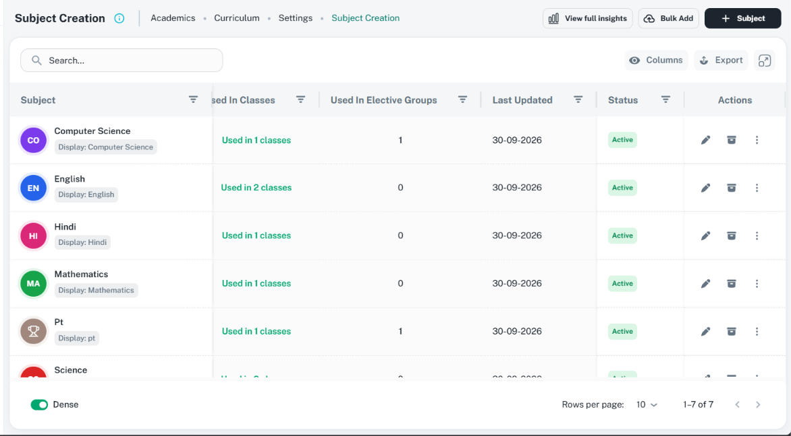

# Table component: ShikshaMitra UI consistency

Use this reference to build or review a record table, including its header, filters, status tabs,
toolbar, cells, row actions, and footer. It replaces the previous table guidance. Use the existing
`CustomizableTable` from the intentionally misspelled `customizabaleTable` folder. The
[design contract](../../../../DESIGN.md), [shared rules](shared-rules.md), and backend permissions
remain governing. An embedded preview/history table may have bounded height; a primary table
fills the remaining workspace height.

Contents: [images](#reference-images), [related components](#component-relationships),
[spacing](#spacing-and-sizing), [buttons](#buttons-and-action-alignment),
[filters and tabs](#filters-and-status-tabs), [API](#current-table-api),
[states](#loading-empty-and-error-states), [review](#inconsistencies).

## Reference images

Supplied by the user and visually inspected on 16 October 2026. Both show light-theme desktop
content. Routes, browser viewport dimensions, and scale are unknown; file dimensions are not CSS
measurements. Neither image has numbered callouts. Do not copy record data or wording defects.

| Reference | Linked asset | State | Preserve |
| --- | --- | --- | --- |
| Subject Creation: Academics / Curriculum / Settings | [Subject table](../assets/table-workspace.png), 1172 x 648 | Populated; no local filter or status-tab rows | Inline title/help/breadcrumbs; secondary actions before create; search left; utilities right; identity cell; status and compact row actions; footer |
| Charges: Finance / Fees | [Filters, tabs, loading](../assets/table-filters-tabs.png), 1173 x 646 | Skeleton rows with Board, Medium, Class, Division and status filters | Separate compact filters, then statuses, then table; count beside each status; same toolbar/footer |




The images establish hierarchy and placement. Confirmed differences from the intended rules are
recorded under [Inconsistencies](#inconsistencies). They do not verify behavior or permissions.

## Component relationships

Links resolve to existing source and guides. Dedicated references for the other common components
can be added later; until then, inspect these APIs instead of inventing props.

| Component | Relationship | Source / related guide |
| --- | --- | --- |
| `CustomizableTable` | Main shared component | [Component](../../../../src/components/customizabaleTable/index.tsx), [IColumn and table props](../../../../src/components/customizabaleTable/types.ts) |
| `CustomBreadcrumbs` | Composed above table: title, help, breadcrumbs, page actions | [Component](../../../../src/components/custom-breadcrumbs/custom-breadcrumbs.tsx), [types](../../../../src/components/custom-breadcrumbs/types.ts), [header guide](page-headers.md) |
| `CustomSelect`, `BoardMediumDropdown` | Optional context outside the table; use the feature's actual selector contract | [Select](../../../../src/components/custom-select/index.tsx), [combined board/medium selector](../../../../src/components/boardMediumDropdown/index.tsx) |
| `CustomTabs`, `useTabs`, MUI `Tabs` / `Tab` | Peer panels use shared tabs; exclusive status filters use the compact treatment below | [Tab guide](custom-tabs.md), [CustomTabs](../../../../src/components/custom-tabs/custom-tabs.tsx), [hook](../../../../src/hooks/use-tabs.ts), [theme](../../../../src/theme/core/components/tabs.tsx) |
| `TableToolbar` | Internal search, Columns popover, Export menu, fullscreen | [Toolbar](../../../../src/components/customizabaleTable/components/TableToolbar.tsx) |
| `FilterChips`, `ColumnFilterMenu` | Internal active column criteria and filter editor | [Chips](../../../../src/components/customizabaleTable/components/FilterChips.tsx), [menu](../../../../src/components/customizabaleTable/components/ColumnFilterMenu.tsx) |
| `TableHeader`, `TableBody`, `useStickyColumns` | Internal headings, cells, measured sticky offsets | [Header](../../../../src/components/customizabaleTable/components/TableHeader.tsx), [body](../../../../src/components/customizabaleTable/components/TableBody.tsx), [sticky hook](../../../../src/components/customizabaleTable/hooks/useStickyColumns.ts) |
| `AdaptiveThreeDotsActions` | Required shared row-action composition; first two actions direct, remaining actions in menu | [Action guide and reference images](adaptive-three-dots-actions.md), [component](../../../../src/components/adaptive-three-dots-actions/index.tsx), [types](../../../../src/components/adaptive-three-dots-actions/types.ts) |
| `ThreeDotsActions`, `CustomPopover`, `usePopover` | Nested within adaptive actions: icon controls and anchored menu | [Actions](../../../../src/components/three-dots-actions/index.tsx), [popover](../../../../src/components/custom-popover/custom-popover.tsx), [hook](../../../../src/components/custom-popover/use-popover.ts) |
| `Label` | Composed in status cells and counts | [Component](../../../../src/components/label/label.tsx) |
| `EmptyContent`, `TableEmptyState`, `TableBodyLoadingRows` | Internal empty and skeleton presentation | [EmptyContent](../../../../src/components/empty-content/empty-content.tsx), [table empty state](../../../../src/components/customizabaleTable/components/TableEmptyState.tsx), [skeleton](../../../../src/components/customizabaleTable/components/TableBodyLoadingRows.tsx) |
| `Scrollbar`, `ComponentBlock` | Internal scrolling and flex layout | [Scrollbar](../../../../src/components/scrollbar/scrollbar.tsx), [block](../../../../src/components/component-block.tsx) |
| MUI `Button`, `IconButton`, `TablePagination`, `Switch` | Page buttons, utilities, pagination, density | [Button theme](../../../../src/theme/core/components/button.tsx), [footer implementation](../../../../src/components/customizabaleTable/index.tsx) |
| `Iconify`, `GlobalIcons`, `CustomTooltip` | Action icons and accessible help | [Iconify](../../../../src/components/iconify/iconify.tsx), [icon map](../../../../src/utils/icons.ts), [tooltip](../../../../src/components/custom-tooltip/index.tsx) |
| `CustomDialog`, `ConfirmDialog` | Fullscreen is internal; feature owns create/edit and consequential actions | [Dialog](../../../../src/components/customDialog/index.tsx), [confirmation](../../../../src/components/confirm-dialog/confirm-dialog.tsx), [form guide](form-dialogs.md), [confirmation guide](confirmations.md) |
| Drawer / record detail | Optional composition preserving table context | [Drawer guide](drawers.md), [detail guide](detail-pages.md) |
| Export / toast | Internal export handling and feedback | [Export](../../../../src/components/customizabaleTable/table-export.ts), [toast](../../../../src/components/toast/index.tsx), [report/export guide](../../shikshamitra-fe-patterns/references/reports-and-exports.md) |

`CommonTable` is an [alternate table implementation](../../../../src/components/commonTable/index.tsx),
not a child of this table. `CustomizableView` is a [draggable section layout](../../../../src/components/customizable-view/index.tsx),
not a table variant. Do not substitute them solely because they appear in the component inventory.

## Page composition and scroll ownership

Use this order; omit unnecessary optional rows completely:

```text
CustomBreadcrumbs: title + help | breadcrumbs       insights | bulk add | create
Optional context surface: Board | Medium | Class | Division
Optional status surface: Pending [count] | In process [count] | Completed [count]
Table card:
  Search...                                      Columns | Export | Fullscreen
  Active column-filter chips (only when criteria exist)
  Sticky column headings
  Scrollable records / skeleton / empty / error
  Dense                                     Rows per page | range | previous/next
```

For the supplied pattern, create actions belong in `CustomBreadcrumbs.action`. Do not repeat them
inside the table toolbar or status row. Preserve module-family header conventions. If an established
module uses a combined filter/action row, keep filters left and actions right there, once each.
For a [CustomTabs workspace](custom-tabs.md), peer tabs and their contextual actions may instead
occupy one row before the panel's filters. This is distinct from the status-filter row below;
render the page action only once and keep the selected panel's context synchronized.

Use an unbroken column-flex chain: root `height: 1`, `minHeight: 0`; every table-containing flex
ancestor `minHeight: 0`; table region `flex: 1`, `minWidth: 0`, `overflow: 'hidden'`. Header and
context rows keep their natural height without shrinking. The table owns both scroll directions;
toolbar/footer sit outside the body scroll. Do not use viewport subtraction or fixed desktop heights.

## Spacing and sizing

Spacing values in `sx` are MUI units, currently 8 px. Radius values multiply the theme's 8 px
shape radius. These are source-backed defaults or explicit composition choices, not pixel guesses
from screenshots. Let text/zoom increase natural heights where necessary.

| Area | Standard | Owner / interpretation |
| --- | --- | --- |
| Header | Existing `px: 1`, `minHeight: 56` | `CustomBreadcrumbs` owns its inset; no second padded wrapper or spacer below it |
| Filter surface | `p: 1`, controls `gap: 1`, `mb: 1` | Composition default: 8 px inset, gaps, separation |
| Status surface | Total `px: 1`, `mb: 1` before table | One inset owner; never outer `px: 1` plus inner `px: 1` |
| Status controls | Between items `gap: 2`; label/count `gap: 1`; minimum target 44 px | Compact underline status-filter pattern |
| Peer-panel tabs | `CustomTabs`: scroller `p: 1`, tab `px: 2`, `py: 1`, minimum 44 px | Preserve shared defaults; no additional scroller inset |
| When tabs are absent | Remove the row and its margin | No reserved blank tab space; filters still have their one `mb: 1` |
| Page action group | `gap: 1`, `alignItems: 'center'`, `justifyContent: 'flex-end'` | Allow wrapping; no individual top/bottom margins |
| Table card | Shared `borderRadius: 2`, border and paper surface | Current radius 16 px; do not add another card around it |
| Toolbar | Shared `p: 2`, `gap: 2`; utility group `gap: 1` | 16 px inset and group separation; 8 px utility gaps |
| Search | Small outlined input, width `100%`, max 300 px, input radius `1.5` | Existing toolbar owns sizing and search/clear icons |
| Headings | Shared `px: 2`, `py: 1.5` | 16 px horizontal, 12 px vertical |
| Body cells | Shared `px: 2`; dense `py: 1.5`, regular `py: 2` | Content sets row height; no forced fixed row height |
| Active filter chips | Shared `p: 2`, spacing `1`, wrapping | Region disappears when no column criteria exist |
| Row actions | Existing 30 x 30 px controls, 16 px icons, `gap: 1` | `ThreeDotsActions` owns sizes; keep usable target separation and focus |
| Footer | Shared `p: 2`; pagination toolbar height/min-height 40 px | Density left, pagination right; preserve shared control order |

On narrow screens wrap/stack filters in reading order, let search and utilities use separate lines,
contain horizontal table scrolling, and allow footer controls to wrap without clipping. Do not
shrink fonts or remove pagination to fit. If the shared footer cannot fit, fix its shared layout
in an implementation task. Preserve usable touch targets without enlarging all labeled buttons.

## Buttons and action alignment

| Action | Component / variant | Contents and location |
| --- | --- | --- |
| Create/open form | MUI `Button`, small, contained, inherit, `type="button"` | Leading `GlobalIcons.addIcon` plus label; rightmost page action |
| Bulk add/import | MUI `Button`, small, outlined, inherit | Upload/import icon plus `Bulk add`; immediately before create when supported |
| Insights | MUI `Button`, small, outlined, inherit | Chart icon plus established insights label; before bulk/create; opens right drawer |
| Columns | Internal small soft inherit button | Eye icon plus `Columns`; first utility at toolbar right |
| Export | Internal small soft inherit button | Export icon plus `Export`; after Columns; format choices in menu |
| Fullscreen | Internal `IconButton` | Maximize/minimize icon and tooltip; last utility; contextual accessible name required |
| Row operations | `AdaptiveThreeDotsActions` | Most common permitted actions first; two direct icons maximum; rest in anchored menu |
| Clear criteria / retry | Small outlined/text button appropriate to state | Within the empty/error region; label the outcome |

- The small labeled-button theme sets height 30 px and non-text horizontal padding 8 px. Let
  labels determine width; use `startIcon` for icon/text spacing. Theme owns typography, radius,
  colors, hover, focus, disabled treatment. Contained inherit adapts to both themes.
- The screenshot screens override create padding to 24/32 px; do not make those local widths a
  universal requirement. Keep page/utility buttons vertically centered, without stretching them
  to the input height. Do not hardcode the screenshot's dark button color.
- Prefer verb-first labels such as `Add charge`. Matching settings pages may retain plus-and-noun
  labels like `Subject`, with `aria-label="Add subject"`. Be consistent within a module family.
- The Subject reference says `View full insights`; the header rulebook uses `View all insights`.
  Preserve established family wording; expose this secondary action only for meaningful data.
- [SubmitButton](../../../../src/components/submit-button/index.tsx) defaults to save/submit and
  belongs inside forms. Use the [form guide](form-dialogs.md) after opening a form; do not use a
  submit button for opening the page's create workflow.
- Filter actions by permission and row state before rendering. Disabled actions use neutral
  colors and explain their reason. Prevent duplicate/conflicting mutations. Every icon action
  needs a meaningful accessible name and tooltip, including record context for row actions.

## Filters and status tabs

- Domain context stays above the table. The Charges reference orders Board, Medium, Class,
  Division. Reuse the feature's selectors, labels, selected values, and dependency resets;
  do not add selectors to a page already scoped by the app shell. Keep valid All options.
- Use small inputs and equal flexible widths for equivalent controls in one row. Wrap/stack
  controls before hiding actions. Keep one inset and the spacing listed above.
- Status choices represent real states, with current scope-wide counts across all pages. Pending
  counts are unknown, not zero. Keep meaningful zero-count states after loading.
- Match the Charges status surface with short labels, a `Label` count beside each, muted inactive
  text, and a selected underline. Semantic count colors do not replace selection. Do not copy
  default `CustomTabs`' filled selection background onto this status-filter treatment.
- Peer content panels use `CustomTabs` and its existing guard/panel relationships. Exclusive
  status filters use button/radio selection semantics, or a complete tab/tab-panel relationship
  when using MUI tabs. Preserve keyboard operation and contained horizontal scrolling.
- Changing context/status resets paging to the first page and updates rows, counts, empty state,
  and insights together. Clear incompatible criteria; preserve unrelated search/sort/display
  context. Preserve meaningful URL-backed state and return context after opening a record.

### Column filter types

Set `filterType` explicitly on each filterable column; do not rely on the text default for numeric
or status fields. Global search searches the full active result set before paging. Column filters
use the displayed meaning and operate across that same full result set.

| Column data | Required configuration | Filter behavior |
| --- | --- | --- |
| Name, description, identifier | `filterType: 'string'` | Text operators; numeric-looking identifiers remain strings |
| Number, count, amount, percentage | `filterType: 'number'` | Numeric comparisons/ranges over the raw numeric value; format only in `render` |
| Status or other fixed choices | `filterType: 'enum'`, with `enumOptions: [{ label, value }]` | Named choices matching displayed labels and actual backend values; no free-text status filter |
| Boolean choices | `filterType: 'enum'`, options for true and false | Explicit `false` is distinct from no criterion |
| Date / timestamp | `filterType: 'date'` / `'dateTime'` | Date-appropriate comparison matching the field's meaning |
| Actions | `isFilter: false`, `isSort: false`, `excludeFromExport: true` | No filter icon/menu, sort trigger/indicator, or export data; omit `filterType` |

The API also supports `'formattedNumber'` for existing formatted-string data. Prefer raw numeric
data with `'number'` in new definitions; do not select a string filter because a cell displays a
currency symbol or percent sign. Preserve backend units and allowed field names. Show removable
criteria and visible sort state only on eligible data columns.

```tsx
// Illustrative IColumn configuration; renderers and backend values belong to the feature.
const columns: IColumn[] = [
  { id: 'name', label: 'Name', align: 'left', filterType: 'string' },
  { id: 'count', label: 'Count', align: 'left', filterType: 'number' },
  {
    id: 'status', label: 'Status', align: 'left', filterType: 'enum',
    enumOptions: [{ label: 'Active', value: 'Active' }, { label: 'Archived', value: 'Archived' }],
    sticky: true, stickyPosition: 'right',
  },
  {
    id: 'actions', label: 'Actions', align: 'left',
    isFilter: false, isSort: false, excludeFromExport: true,
    sticky: true, stickyPosition: 'right',
    // render: compose AdaptiveThreeDotsActions using the linked action guide.
  },
];
```

## Columns, cells, and row actions

- Identity first, useful comparison fields next, Status immediately before Actions where relevant.
  Actions stays rightmost. Explicitly set `sticky: true, stickyPosition: 'right'` for Status and
  Actions; left-sticky identity is optional. Use shared measured offsets, not local pixel offsets.
- Sticky cells use opaque theme surfaces, subtle separation, and matching header/body widths.
  Identity/description absorbs useful space; Status/Actions fit contents without stretching.
  Wrap long values or expose full text accessibly; avoid arbitrary widths causing overflow.
- Every column heading/label is left aligned, including Number, Status, and Actions. Use
  `align: 'left'` for the column; when numeric body cells need right alignment, use
  `cellSx: { textAlign: 'right' }` without moving the heading. Header helpers and custom labels
  must keep the same left alignment. This user requirement supersedes centered/right-aligned
  headings shown in older screens or reference images.
- Body text aligns left; numeric values may align right for comparison. The compact action group
  can align right within its cell via `sx={{ justifyContent: 'flex-end' }}` while its Actions
  heading stays left. Identity avatars/secondary chips are optional; do not repeat names without
  a user benefit. Review every column for decision value.
- Use `Label` and a central semantic mapping for status. Use shared date/number/currency formatters,
  meaningful missing values, and correct singular/plural wording. Do not turn image data into fixtures.
- Actions uses `isSort: false`, `isFilter: false`, `excludeFromExport: true`. Omit its filter type
  and never add a filter, sorting arrow/priority, or sortable heading. Its `render` must compose
  `AdaptiveThreeDotsActions`, as shown in the [dedicated guide](adaptive-three-dots-actions.md).
- Give actions record-specific labels, such as `Edit English` and `More actions for English`.
  With zero actions render nothing; one/two actions remain direct with no three dots. With more
  than two, keep the first two outside and put every remaining action in three dots. Never repeat
  direct actions in overflow. Use `directActionLimit={2}`, `collapseOnOverflow={false}` and retain
  the same default mobile limit for this pattern; do not collapse all actions into the menu.
- Menus anchor to the trigger, avoid clipping, and close on selection/outside click/Escape with
  appropriate focus behavior. Action clicks must not trigger row navigation. Real navigation uses
  links; `handleRowClick` alone is not a keyboard-accessible record action.
- Follow [confirmations](confirmations.md) for consequential operations. Archive and Delete are
  different outcomes; an icon in the image does not authorize either operation.

## Current table API

Inspected on 16 October 2026; recheck [types](../../../../src/components/customizabaleTable/types.ts)
and implementation when using this guide. This map does not replace the type definitions.

| Need | API / constraint |
| --- | --- |
| Identity | Required `tableId`, `columns: IColumn[]`, `data: IData[]`; contextual string `tableTitle` also supplies the accessible table name and fullscreen title |
| Fill height | `wrapperProps={{ sx: { flex: 1, minHeight: 0 } }}`, `tableContainerProps={{ sx: { height: 1 } }}` inside the flex chain above |
| Search | `isSearch`, `searchFieldProps`, `searchableFields`, controlled `searchTerm`, `onSearchInputChange`, `onServerSearch`; contextual name via `searchFieldProps.inputProps` |
| Toolbar/footer | `showToolbar`, `isFilter`, `isShowedDense`, `isPagination`; currently `isFilter` gates Columns/Export/Fullscreen together and `isShowedDense` gates the whole footer, including pagination |
| Paging | Controlled `page` is zero-based; `onServerPagination(page, rowsPerPage)` reports one-based pages; preserve `totalCount`, `rowsPerPage`, `rowsPerPageOptions`, `maxServerRowsPerPage` |
| Server operations | Wire matching `serverSidePagination`, `serverSideSearch`, `serverSideSort`, `serverSideFilter` flags and callbacks; `serverSide` alone does not wire these behaviors |
| Column criteria | `filterType`, `enumOptions`, `isFilter`, `isSort`; controlled `filters` / `sorts` use `IParams`; callbacks serialize only supported backend fields |
| Content states | `isLoading` replaces rows with skeleton; `errorContent` supplies error/retry; `noDataText` is ReactNode empty content; no public `isRefreshing` or `onRetry` prop |
| Export | `exportLabel`, `tableTitle`, `excludeFromExport`; built-in export receives current `sortedData`, which is only the loaded data under server paging |

For growing datasets use server operations over the full active scope: filter/search before
counting/paging, stable sorting with a tie-breaker before paging. Never sort/filter only one fetched
page. Do not describe a loaded-page export as a full-result export; use the established report/export
flow when full results are required. Respect backend page-size caps and avoid unbounded All requests.
Current defaults are page size 10, base options 10/25/100 plus a conditional All option, and density
on. Persistent display preferences require actual feature wiring; `tableId` alone does not prove it.

## Loading, empty, and error states

Read [empty-loading-states.md](empty-loading-states.md) for EmptyContent/SearchNotFound APIs,
skeletons, state messages/icons/spacing, status accessibility, and FormBusyRegion in related forms.
Keep the table-specific integration and geometry below.

Keep header, context, statuses, toolbar, headings, and footer mounted with stable geometry.

| State | Presentation / action |
| --- | --- |
| Initial loading | Shared skeleton via `isLoading`; preserve context/column widths. Charges image shows pending data, not a completed empty result |
| Safe same-scope refresh | Retain valid rows and compose a thin labelled progress indicator in the owning feature; there is no separate table refresh prop |
| Scope transition | Show honest pending state; do not present previous-scope rows/counts as current |
| Empty dataset | Center complete message/help/action group; offer create only when valid and permitted |
| Search no-results | Describe search, retain term, offer `Clear search`; no create action |
| Column-filter no-results | Explain criteria; `Clear filters` or `Clear search and filters` when both apply |
| Domain/status no-results | Feature supplies scoped `noDataText` and reset/change-scope action; built-in detection only knows table search/column filters |
| Missing prerequisite | Explain required selection/configuration, offer a valid resolution; avoid unscoped query |
| Error | `errorContent` with useful explanation and safe retry; never successful-empty content |

`TableEmptyState` wraps `noDataText` in `EmptyContent.title`; custom content must be valid for
that render context. Extend the shared API in an implementation task if richer content needs it.
Center the complete group in the visible body even during horizontal scroll. Pagination range,
selected size, and previous/next availability must agree with active data; pending zero is not empty.

## Verification

- Check order, spacing ownership, optional tab gaps, remaining-height fill, and scroll ownership.
- Check buttons, action order/permissions, disabled reasons, two-direct-action limit, menus,
  confirmations, focus, and return context.
- Check every heading is left aligned, numbers use `filterType: 'number'`, statuses use
  `filterType: 'enum'` with options, and Actions has no filter or sorting controls.
- Check search/filter/status combinations, sort before paging, page resets, counts, page size,
  export scope, loading, no-results, prerequisites, and error/retry states.
- Check both themes, long text, keyboard, accessible names, sticky alignment, and narrow viewports.
  Desktop images cannot establish those checks.
- For UI implementation changes run focused checks and the required in-app browser smoke test.
  For documentation-only work validate links/assets, skill structure, and whitespace.
- Record `Consistent`, `Inconsistent`, or `Unverified` with evidence. End reviews with confirmed
  inconsistencies separate from unverified behavior.

## Inconsistencies

Source-and-reference review only; changing this guide does not fix the runtime.

| Evidence | Observed mismatch | Required treatment when implementing |
| --- | --- | --- |
| Subject image and [subject table](../../../../src/screens/academic/curriculum-management/setting/subjectCreation/settingSubjectTable.tsx) | `Used in 1 classes`; identity heading crowds the next heading; Actions centers controls | Correct singular/plural; verify sticky widths/overlap; right-align compact action group |
| Subject table source | Actions lacks explicit `excludeFromExport: true`; shared export currently also excludes action-named columns | Add explicit exclusion for clarity; this is configuration debt, not evidence that actions currently export |
| [Charges table](../../../../src/screens/finance/ChargesManagement/Components/ChargesManage/Component/ChargesTable.tsx) | Outer status surface `px: 1` plus inner Tabs `px: 1` doubles the specified inset | Keep one `px: 1` owner |
| Charges image | Skeleton rows accompany zero counts and an incomplete page-size value | Treat pending counts as unknown; preserve selected page size; verify request transitions before attributing a runtime cause |
| Shared toolbar | Fullscreen has tooltip but no explicit `aria-label` | Supply contextual accessible name |
| Shared table | Hiding density hides pagination too; server-paged export receives loaded data | Separate controls or provide supported export integration when needed; no invented props |
| Existing screens and supplied action references | Some headings, including Actions, are centered/right aligned | Apply the user's left-aligned heading requirement when implementing; body-value alignment is separate |

Unverified: live viewport matching, keyboard, permissions, network timing/errors, dark theme,
mobile/footer wrapping, and sticky behavior during scrolling. This task inspected source and
the two supplied images without changing or running the application.
