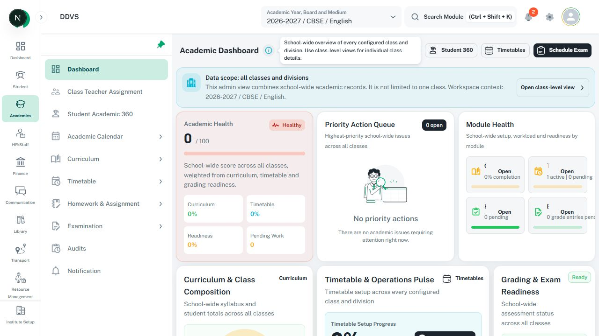

# Tooltips and contextual popovers

Follow [DESIGN.md Tooltip](../../../../DESIGN.md#16-tooltip). Use supplementary help near the
control it explains; keep essential consequences, restrictions, and errors visible in the body.

## Choose and compose

| Need | Current component / API |
| --- | --- |
| Concise non-interactive help | [CustomTooltip](../../../../src/components/custom-tooltip/index.tsx), MUI Tooltip props including `title`, `placement`, and child; it does not render a trigger for you |
| Interactive anchored content | [CustomPopover](../../../../src/components/custom-popover/custom-popover.tsx), [types](../../../../src/components/custom-popover/types.ts): MUI Popover props, `anchorEl`, `open`, `onClose`, `slotProps.arrow` |
| Table row actions | [AdaptiveThreeDotsActions](adaptive-three-dots-actions.md); preserve its existing menu owner rather than assembling a competing popover |
| Dialog or section guidance | Use the owning shell's `titleInfo` or section help API from [sections](sections.md) |

- Prefer right placement for icon-triggered explanatory tooltips, allowing collision handling to
  flip. Do not hardcode screen coordinates or a feature-specific z-index copied from a workaround.
- Give icon-only triggers their own accessible name. The child must accept the required ref/events
  and be focusable; wrap disabled controls appropriately without making the disabled action run.
- Keep help available on keyboard focus and touch. Do not rely on hover to reveal an essential step.
- Use a popover for controls, links, or longer interactive content. Name its trigger and panel,
  expose expanded state where appropriate, and keep focus/dismissal consistent with its role.
- Close a popover safely on Escape/click-away when idle and return focus to its trigger. Selecting
  help must not change an adjacent field value or activate its table row.
- Shared popover arrow placement belongs to `slotProps.arrow.placement`; inspect the current
  supported values. No generic `arrowPlacement` or `renderTrigger` prop is provided.
- Use the theme's surface, text, radius, shadow, and collision behavior. Keep one anchor/state owner.

## Reference and checks

This is a header-help reference, not an interactive menu or proof of every tooltip state.
See [capture metadata](image-references.md#local-app-captures-22-october-2026). For menu appearance,
reuse the [existing open row-action image](../assets/adaptive-three-dots-actions-open.png).
Check keyboard opening/closing, focus return, click propagation, viewport edges, long help, and
anchors inside scrolling dialogs/drawers. Follow the owning busy lock during mutations.
