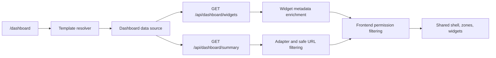

# Dashboard

This is the start-here guide for `/dashboard`. The dashboard is a template-driven ERP command center for Indian schools, not a separate page for every school role. It gives each user a daily operating view of KPIs, pending work, risks, calendar items, announcements, and drilldowns into existing module screens.

## Templates

| Template | Typical users | Intent |
| --- | --- | --- |
| `leadership` | Owner, director, board, super admin | School pulse, finance health, compliance, risks, and module health. |
| `principalAdmin` | Principal, vice principal, admin manager, IT/admin staff | Morning operations, attendance, approvals, safety, calendar, and module drilldowns. |
| `teacher` | Teacher, HOD, academic coordinator, class teacher | Assigned-class context, pending academic work, student follow-up, and teaching drilldowns. |
| `financeHr` | Finance officer, HR manager, payroll or attendance operator | Fee, dues, concession, payroll, staff attendance, and HR/Finance actions. |
| `studentParent` | Student, parent, guardian | Personal attendance, assignments, fee, documents, and academic result summary only when the user email resolves to exactly one enrolled student; otherwise readiness and drilldowns. |

Custom school roles should map to one of these templates through Security configuration. Seeded role-name fallback exists only as compatibility behavior.

## Runtime Flow

Production rendering uses the backend summary API by default. Mock and contract-preview sources are development/test paths only unless explicitly enabled by environment flags. Backend widget metadata is preferred for widget permissions, owners, and drilldowns; the frontend registry remains a temporary fallback.

The backend applies dashboard slices through a registered pipeline. Slice order, slice name, and affected warning zone are explicit so a failed slice can return a `zoneErrors` warning without blanking the rest of the dashboard.

## Current Live Scope

Live dashboard enrichment is limited to existing scoped sources:

| Area | Current behavior |
| --- | --- |
| Student records | Live scoped enrolled-student count for the Leadership total-students KPI. |
| Student attendance | Live scoped attendance for Leadership and Principal/Admin widgets. |
| Action queue | Selected live counts for admissions, HR leave/payroll, and finance reconciliation. |
| Academic curriculum, exams, and results | Live scoped curriculum completion, Leadership academic health, Principal/Admin pacing risk/module health, Principal/Admin exam marks workflow backlog, and Principal/Admin published/frozen result pass-rate follow-up from existing Academic records. |
| Finance/HR | Live scoped fee collection, dues, concessions, payroll readiness, Principal/Admin teaching-staff attendance, Finance/HR staff attendance, and module health where source data exists. |
| Calendar | Next visible calendar item through the Calendar view reader. |
| Compliance | Local ERP readiness for APAAR, PEN, and UDISE fields; not official portal status. |
| Teacher | Limited live assigned-class context, assigned-class attendance action count, assigned-class published/frozen result pass-rate, scoped assigned-subject exam marks workflow count, and creator-owned learning-task review count when the user maps to one active employee and scoped sources exist. |
| Student/Parent | Limited personal attendance percentage, open learning-task count, outstanding fee amount, required-document action, and latest published/frozen academic result summary when the authenticated email matches exactly one enrolled student contact or parent/guardian email. |

Readiness or drilldown-only areas:

- Academic student-level risk aggregates; announcements; transport/security exception counts; and safety incident counts.
- Teacher workload beyond creator-owned homework/assignment submissions pending review.
- Student/Parent transport and safety values until their owning modules expose trusted personal sources.
- Official UDISE+, APAAR, CBSE, or safety certificate submission status.

## Safety Rules

- Backend authorization and server-side permission filtering are authoritative.
- Dashboard aggregates must use module-owned scoped readers or apply the same UserScope rules as the owning module.
- Student/Parent personalization must resolve to exactly one enrolled student by authenticated email; no match or multiple matches keeps readiness-only content.
- Frontend permission filtering is defense in depth and must hide denied or unknown widgets after permissions initialize.
- Every visible widget must be actionable through a safe relative `drilldownUrl` or accountable through an `owner`.
- Slice failures should return `zoneErrors`, restore the affected dashboard content to its base/readiness state, and keep unaffected zones usable.

## Documentation Map

| Document | Use |
| --- | --- |
| [PRD](prd.md) | Product goal, templates, India-specific readiness, and high-level requirements. |
| [Implementation plan](implementation-plan.md) | Phase history and quality gates. |
| [Data contract](data-contract.md) | Summary API, metadata API, adapter behavior, `zoneErrors`, and UserScope expectations. |
| [Permission and scope safety](permission-scope-safety.md) | Frontend widget gating and backend scope rules. |
| [Testing and acceptance](testing-and-acceptance.md) | Current acceptance checklist and validation commands. |
| [Release checklist](release-checklist.md) | Final dashboard-only sign-off commands and deferred source rules. |
| [Architecture ADR](../../../Shikshamitra-BE/docs/architecture/decisions/004-dashboard-command-center-contract.md) | Command-center contract and metadata ownership decision. |
